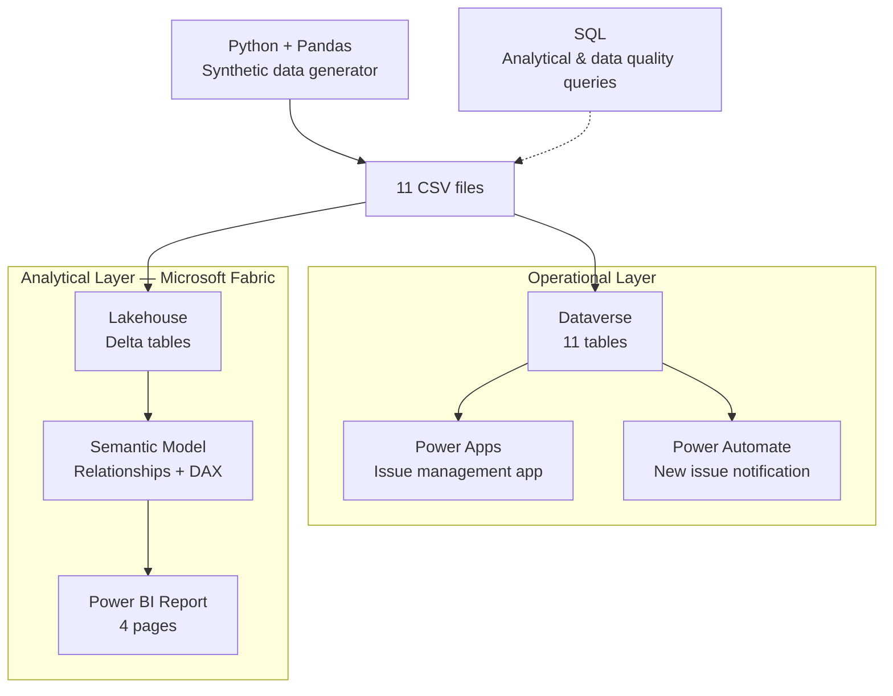
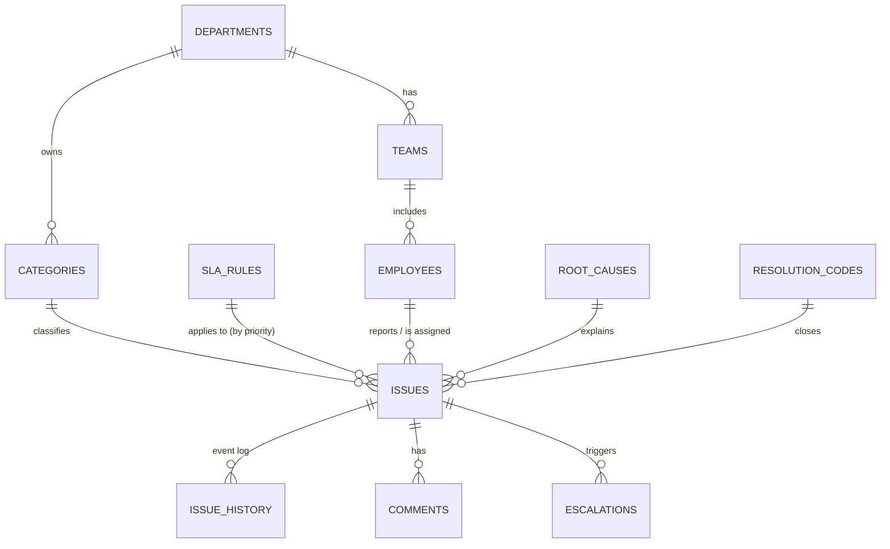

# OpsInsight — Operational Issue & SLA Intelligence Platform

> End-to-end **Microsoft Power Platform** solution for centralized issue management, SLA tracking and operational analytics.
> Fictional company: **Northstar Operations Group** · All data is synthetic.


---

## The Problem

In many organizations, operational issues — broken equipment, delayed approvals, system errors — are reported through **email, spreadsheets, Teams messages and phone calls**. Because the records are scattered, management cannot answer basic questions:

- How many issues are open right now?
- Which departments generate the most issues?
- Which teams consistently miss their SLA targets?
- At which stage of the process do issues stall?
- Is operational performance improving over time?

Issues get solved, but they are **not measured** — and what is not measured cannot be improved.

## The Solution

OpsInsight centralizes issue reporting in one application and turns daily operational activity into **measurable data** that management can act on.

**Capture → Manage → Monitor → Analyze → Improve**

| Need | Solution | Tool |
|------|----------|------|
| Report issues in one place | App to create, list and update issue records | **Power Apps** |
| Structured, relational data | Issues, departments, teams, SLA rules, event history | **Dataverse** |
| Keep the right people informed | Email notification when a new issue is created | **Power Automate** |
| Give management visibility | KPIs, SLA compliance, department/category breakdown, trends | **Power BI + Microsoft Fabric** |
| Realistic test data | 2,200 issues and 11,000+ lifecycle events | **Python + Pandas** |
| Analysis & data quality | SLA, process and data quality queries | **SQL** |

---

## Architecture

The solution separates the **operational layer** (live records, app, automation) from the **analytical layer** (historical data, reporting) — a common pattern in enterprise data platforms.



---

## Data Model



| Table | Rows | Description |
|-------|-----:|-------------|
| `issues` | 2,200 | Core issue records (priority, status, SLA, timestamps) |
| `issue_history` | 11,232 | Append-only event log of every status change |
| `comments` | 4,073 | Comments on issues |
| `escalations` | 315 | SLA breach escalations |
| `employees` | 96 | Requesters, agents and managers |
| `categories` | 24 | Issue categories per department |
| `teams` | 10 | Operational teams |
| `root_causes` | 10 | Root cause catalogue |
| `resolution_codes` | 9 | How issues were resolved |
| `departments` | 6 | IT, Finance, HR, Procurement, Operations, Sales Ops |
| `sla_rules` | 4 | Response / resolution targets by priority |

The synthetic data contains **intentional behavioural patterns** (e.g. some teams breach SLA more often, some categories reopen more frequently) so the dashboards surface meaningful insights.

Full field definitions: [`docs/data-model.md`](docs/data-model.md) · [`power-bi/data-dictionary.md`](power-bi/data-dictionary.md)

---

## Power BI Report (Microsoft Fabric)

CSV files were loaded into a **Fabric Lakehouse** as Delta tables ([loader notebook](power-platform/solution-notes/fabric_load_tables.py)), modelled in a **Semantic Model** and visualized in a 4-page report.

| Page | Content |
|------|---------|
| **1. KPI Dashboard** | Total / open / resolved issues, SLA compliance %, average resolution time |
| **2. Department & Category** | Issue volume and performance by department and category |
| **3. SLA & Trend** | SLA compliance over time, breaches by priority |
| **4. Issue List** | Detailed issue table with Status, Priority, Department and Month slicers |

DAX measures: [`power-bi/measures.md`](power-bi/measures.md)

<!-- SCREENSHOTS: Power BI


-->

<!-- SCREENSHOTS: Fabric


-->

---

## Power Apps & Dataverse

All 11 tables were created in **Dataverse** from the generated CSV files. A Power Apps application built on the `Issue` table supports:

- Browsing and searching issue records
- Viewing issue details
- Creating and editing issues through a form

<!-- SCREENSHOTS: Dataverse & Power Apps


-->

---

## Power Automate

**New Issue Notification** — automated cloud flow:

1. **Trigger:** Dataverse — *When a row is added* to the `Issue` table (scope: Organization)
2. **Action:** Office 365 Outlook — *Send an email (V2)* with Issue Number, Title, Priority and Description

> **Note:** The Dataverse connector is a Premium connector. The flow is fully designed and saved; running it requires a Power Automate Premium licence or trial, which is outside this project's free-tier scope.

<!-- SCREENSHOTS: Power Automate

-->

---

## Python & SQL

**Python** — [`python/generate_data.py`](python/generate_data.py) generates the full relational dataset with Pandas + Faker; [`python/validate_data.py`](python/validate_data.py) checks referential integrity, nulls, date logic and value ranges.

**SQL** — PostgreSQL-compatible reference scripts:

| Script | Purpose |
|--------|---------|
| [`01_schema_reference.sql`](sql/01_schema_reference.sql) | Table definitions, keys and constraints |
| [`02_operational_queries.sql`](sql/02_operational_queries.sql) | Open issues, workload, volume by department |
| [`03_sla_analysis.sql`](sql/03_sla_analysis.sql) | SLA compliance and breach analysis |
| [`04_process_analysis.sql`](sql/04_process_analysis.sql) | Time spent per lifecycle stage (bottlenecks) |
| [`05_data_quality_checks.sql`](sql/05_data_quality_checks.sql) | Data quality validation |

---

## Technology Stack

| Layer | Technology |
|-------|-----------|
| Application | Power Apps |
| Operational database | Microsoft Dataverse |
| Automation | Power Automate |
| Analytics platform | Microsoft Fabric (Lakehouse, Semantic Model) |
| Reporting | Power BI, DAX |
| Data generation | Python, Pandas, Faker |
| Analytical queries | SQL (PostgreSQL-compatible) |
| Version control | Git, GitHub |

**Cost: £0** — built entirely on free developer and trial tiers.

---

## How to Run

### 1. Generate the dataset

```bash
cd python
python -m venv venv
source venv/bin/activate        # Windows: venv\Scripts\activate
pip install -r requirements.txt
python generate_data.py
python validate_data.py
```

CSV files are written to `data/generated/`.

### 2. Power Platform & Fabric

See [`docs/deployment-guide.md`](docs/deployment-guide.md) for Dataverse, Power Apps, Power Automate and Power BI setup steps.

---

## Project Structure

```
opsinsight-power-platform/
├── README.md
├── docs/                       # Requirements, architecture, specs, deployment guide
├── python/
│   ├── generate_data.py        # Synthetic data generator
│   ├── validate_data.py        # Data quality checks
│   └── requirements.txt
├── sql/                        # Schema, operational, SLA, process & DQ queries
├── power-bi/
│   ├── data-dictionary.md
│   ├── measures.md             # DAX measures
│   └── report-design.md        # Original report design specification
├── power-platform/
│   ├── tables/                 # Dataverse table definitions
│   └── solution-notes/         # Fabric Lakehouse loader notebook
├── data/generated/             # Generated CSVs (git-ignored, run the generator)
└── screenshots/                # Report and app screenshots
```

---

## Roadmap

- [ ] Process bottleneck page in Power BI using the `issue_history` event log
- [ ] Root cause analysis page
- [ ] Dataverse business rules for automatic SLA assignment
- [ ] Custom Power Apps screens (home dashboard, filters, priority badges)
- [ ] Run SQL scripts locally with DuckDB
- [ ] GitHub Actions workflow for automated data validation

---

*Portfolio project — not intended for production. All data is synthetic; no real personal data is used.*
