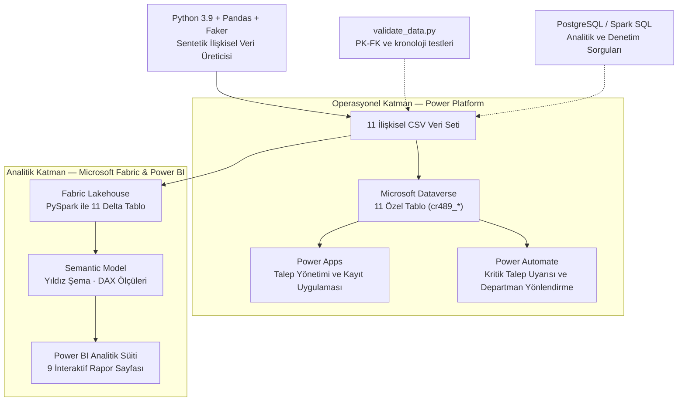
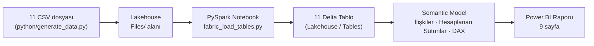
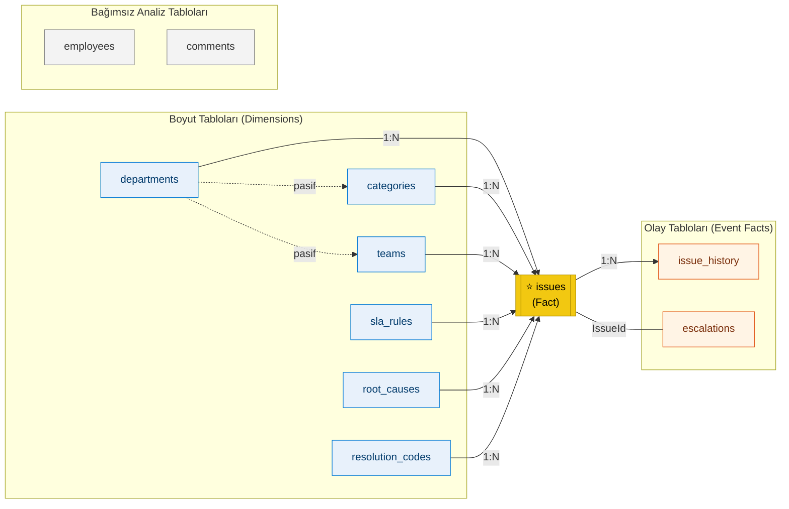
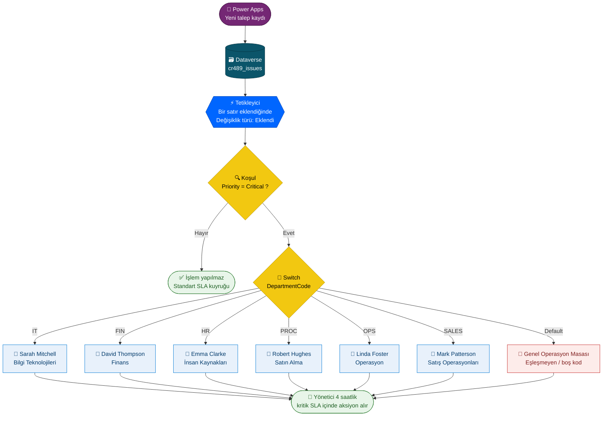
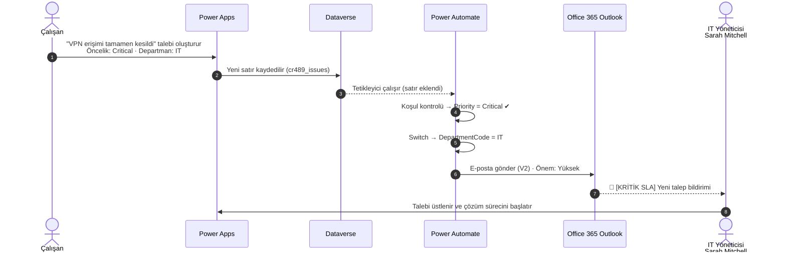

# OpsInsight — Operasyonel Sorun, SLA & Süreç Zekası Platformu

> **Kurumsal Portföy Projesi** — **Microsoft Power Platform** ve **Microsoft Fabric** üzerinde geliştirilmiş, uçtan uca operasyonel zeka ve süreç analitiği platformu.  
> Kurgusal organizasyon: **Northstar Operations Group** · Tüm veriler sentetiktir.


---

## 📑 İçindekiler

1. [Yönetici Özeti](#-yönetici-özeti-executive-summary)
2. [Öne Çıkan Operasyonel Bulgular](#-öne-çıkan-operasyonel-bulgular)
3. [Sistem Mimarisi](#️-sistem-mimarisi)
4. [İlişkisel Veri Modeli](#️-i̇lişkisel-veri-modeli-11-tablo)
5. [Microsoft Fabric — Lakehouse & Semantic Model](#-microsoft-fabric--lakehouse--semantic-model)
6. [Power BI Analitik Süiti](#-power-bi-analitik-süiti-9-sayfa)
7. [Power Apps](#-power-apps--operasyonel-talep-yönetimi-uygulaması)
8. [Microsoft Dataverse](#️-microsoft-dataverse--özel-veri-katmanı)
9. [Power Automate](#-power-automate--kritik-talep-uyarısı-ve-departman-bazlı-akıllı-yönlendirme)
10. [Python & SQL Katmanı](#-python--sql-veri-mühendisliği-katmanı)
11. [Proje Dizin Yapısı](#-proje-dizin-yapısı)
12. [Sergilenen Yetkinlikler](#-sergilenen-temel-yetkinlikler)

---

## 📌 Yönetici Özeti (Executive Summary)

Kurumsal şirketlerde departmanlar arası operasyonel aksaklıklar (donanım arızaları, geciken onaylar, hatalı faturalar, sistem entegrasyon kopuklukları) çoğunlukla e-posta, Excel tabloları, Teams yazışmaları veya telefon görüşmeleri gibi dağınık kanallardan yürütülür. Bu durum; yönetimin iş yükünü ölçemediği, SLA taahhütlerini denetleyemediği ve süreç darboğazlarını tespit edemediği ciddi bir operasyonel kör nokta oluşturur.

**OpsInsight**, tüm departmanlardaki sorun bildirimlerini tek bir merkezde toplar ve günlük operasyonel hareketleri **ölçülebilir, denetlenebilir ve aksiyona dönüştürülebilir süreç zekasına** dönüştürür.

**Temel Çalışma Prensibi: Kaydet → Yönet → İzle → Analiz Et → İyileştir**

```
Çalışanlar / Operasyon Temsilcileri / Yöneticiler
                        │
                        ▼
             Power Apps Canvas App
         (Canlı talep yönetimi ve kayıt formu)
                        │
                        ▼
               Microsoft Dataverse
     (11 ilişkisel tablo ve operasyonel iş kuralları)
           /                         \
          ▼                           ▼
    Power Automate          Microsoft Fabric (Lakehouse)
 (Kritik talep uyarısı &              │
  departman yönlendirme)              ▼
                        Semantic Model (Star Schema)
                                      │
                                      ▼
                             Power BI Analitiği
                          (9 sayfalık kurumsal süit)
```

---

## 🔎 Öne Çıkan Operasyonel Bulgular

Power BI raporundan elde edilen ve yönetim aksiyonu gerektiren başlıca bulgular:

| # | Bulgu | Kanıt | Önerilen Aksiyon |
|:-:|---|---|---|
| 1 | **Satın Alma en zayıf halka** | Ort. çözüm **25,17 saat** (kurum ort. 17,84) · SLA uyumu **%54** | Tedarikçi bağımlı taleplere ayrı SLA ve tedarikçi takip süreci |
| 2 | **Finans'ta kronik tekrar açılmalar** | **56** yeniden açılma (en yüksek) · SLA uyumu **%64** | Kapanış öncesi doğrulama adımı ve kök neden denetimi |
| 3 | **İhlallerin ağırlığı Orta öncelikte** | 881 ihlalin **393'ü** Medium · eskalasyonların **%44,76'sı** Medium SLA aşımı | Medium SLA hedefinin (24 saat) ve kuyruk önceliklendirmesinin gözden geçirilmesi |
| 4 | **Veri kalitesi baskın kök neden** | Treemap'te en büyük pay: Data Quality, Missing Information, Process Design | Kaynak sistemlerde zorunlu alan ve doğrulama kuralları |
| 5 | **Satış Operasyonları örnek departman** | SLA uyumu **%94** · yalnızca **2** yeniden açılma | Süreç pratiklerinin diğer departmanlara aktarılması |
| 6 | **Kurum geneli hedefin altında** | SLA uyumu **%78,14** vs. **%90** hedef · eskalasyon oranı **%14,32** | Departman bazlı aylık SLA hedef takibi |

---

## 🏛️ Sistem Mimarisi

Çözüm; canlı iş uygulamalarının ve otomasyonun çalıştığı **Operasyonel Katman** ile veri ambarı ve analitik modellemenin çalıştığı **Analitik Katman**'ı birbirinden net biçimde ayırır. Bu iki katmanlı yapı, gerçek kurumsal veri platformu mimarisini yansıtır.



---

## 🗄️ İlişkisel Veri Modeli (11 Tablo)

Python ile üretilen ve gerçekçi iş kuralları içeren **2.200 talep** ile **11.232 yaşam döngüsü olayı**, hem Dataverse'e hem de Microsoft Fabric Lakehouse'a yüklenmiştir.

| Tablo | Kayıt | Rol | Açıklama | Birincil Anahtar |
|---|---:|:-:|---|---|
| `issues` | 2.200 | **Fact** | Ana hareket tablosu: öncelik, durum, SLA hedefi, zaman damgaları | `IssueId` |
| `issue_history` | 11.232 | Fact (olay) | Süreç denetim günlüğü: durum değişiklikleri, atamalar, transferler | `HistoryId` |
| `comments` | 4.073 | Fact (olay) | Dahili ekip notları ve talep sahibiyle yazışmalar | `CommentId` |
| `escalations` | 315 | Fact (olay) | SLA aşımlarında üst yöneticiye yapılan müdahale kayıtları | `EscalationId` |
| `employees` | 96 | Dimension | Talep sahipleri, operasyon temsilcileri ve ekip müdürleri | `EmployeeId` |
| `categories` | 24 | Dimension | Departmanlarla eşleştirilmiş operasyonel kategori listesi | `CategoryId` |
| `teams` | 10 | Dimension | Uzmanlaşmış operasyon ekipleri (IT Altyapı, Finans Operasyon...) | `TeamId` |
| `root_causes` | 10 | Dimension | Standart kök neden kataloğu (Veri Kalitesi, Eksik Onay...) | `RootCauseId` |
| `resolution_codes` | 9 | Dimension | Kapanış yöntemi sınıflandırması (Yapılandırma Güncellendi...) | `ResolutionCodeId` |
| `departments` | 6 | Dimension | IT, Finans, Satın Alma, İK, Operasyon, Satış Operasyonları | `DepartmentId` |
| `sla_rules` | 4 | Dimension | Öncelik bazlı SLA hedefleri (Critical 4s · High 8s · Medium 24s · Low 72s) | `SLAId` |

---

## 🧊 Microsoft Fabric — Lakehouse & Semantic Model

### 1. Veri Yükleme Hattı (Ingestion)



- [`fabric_load_tables.py`](power-platform/solution-notes/fabric_load_tables.py) her CSV'yi şema çıkarımıyla (`inferSchema`) okur ve `overwrite` moduyla **Delta** formatında yönetilen tabloya yazar.
- Script **idempotent** çalışır; tekrar çalıştırıldığında tablolar çoğalmaz, güncel veriyle yeniden oluşturulur.
- Delta formatı; ACID işlem güvencesi, şema denetimi ve sürüm geçmişi (time travel) sağlar.

### 2. Model Mimarisi

Model, merkezde `issues` fact tablosunun bulunduğu **Kimball yıldız şeması** (Star Schema) prensibiyle tasarlanmıştır. Boyut tabloları `issues` tablosunu **bire-çok (1:N)** ve **tek yönlü** ilişkilerle filtreler; olay tabloları (`issue_history`, `escalations`) ise talep üzerinden detaya iner.




### 3. İlişki Envanteri

| # | Kaynak (1) | Hedef (N) | Anahtar | Durum | Filtre Yönü |
|:-:|---|---|---|:-:|:-:|
| 1 | `departments` | `issues` | `DepartmentId` | ✅ Aktif | Tek yönlü |
| 2 | `categories` | `issues` | `CategoryId` | ✅ Aktif | Tek yönlü |
| 3 | `teams` | `issues` | `TeamId → AssignedTeamId` | ✅ Aktif | Tek yönlü |
| 4 | `sla_rules` | `issues` | `SLAId` | ✅ Aktif | Tek yönlü |
| 5 | `root_causes` | `issues` | `RootCauseId` | ✅ Aktif | Tek yönlü |
| 6 | `resolution_codes` | `issues` | `ResolutionCodeId` | ✅ Aktif | Tek yönlü |
| 7 | `issues` | `issue_history` | `IssueId` | ✅ Aktif | Tek yönlü |
| 8 | `issues` | `escalations` | `IssueId` | ✅ Aktif | Tek yönlü |
| 9 | `departments` | `teams` | `DepartmentId` | ⏸️ Pasif | — |
| 10 | `departments` | `categories` | `DepartmentId` | ⏸️ Pasif | — |

### 4. Modelleme Kararları

| Karar | Gerekçe |
|---|---|
| **Yıldız şema, kar tanesi (snowflake) değil** | Tüm boyutlar doğrudan `issues` tablosuna bağlanır. Filtre zinciri kısalır, DAX sorguları sadeleşir ve performans artar. |
| **Tek yönlü (single) çapraz filtre** | Çift yönlü ilişkilerin yaratacağı belirsiz sonuçlar ve performans kaybı önlenir; filtre her zaman boyuttan fact tablosuna akar. |
| **`departments → teams/categories` ilişkileri pasif** | `departments` zaten `issues`'a doğrudan bağlıdır. Bu ilişkilerin aktif olması, aynı tabloya iki farklı filtre yolu açarak **belirsizlik (ambiguity)** yaratırdı. Gerektiğinde `USERELATIONSHIP()` ile ölçü bazında etkinleştirilebilir. |
| **`employees` bağımsız tutuldu** | Bir çalışan aynı talepte birden fazla rol üstlenir (talep sahibi, atanan temsilci, yönetici). Bu "role-playing" boyutu birden fazla pasif ilişkiyle yönetmek yerine, `issues` tablosundaki **denormalize** isim alanları (`CreatedByName`, `AssignedAgentName`) kullanıldı. |
| **`comments` kendi içinde analiz edilir** | Yorum hacmi ve iletişim profili analizleri (Sayfa 8) yalnızca `comments` tablosundaki alanlarla yapılır; gereksiz ilişki yükünden kaçınılır. |
| **Denormalize metin alanları** | `DepartmentCode`, `CategoryName`, `AssignedTeamName` gibi alanlar raporlama hızını artırır ve Power Automate yönlendirmesinde doğrudan kullanılır. |
| **Zaman damgaları eksende kullanılmaz** | Saniye hassasiyetli `CreatedAt` yerine `CreatedMonth` hesaplanan sütunu kullanılır; kategorik eksenlerde binlerce ince çubuk oluşması engellenir. |

### 5. Hesaplanan Sütunlar (Calculated Columns)

Satır düzeyinde bir kez hesaplanan ve filtre/eksen olarak kullanılan alanlar:

| Sütun | Tür | Mantık | Kullanım Amacı |
|---|---|---|---|
| `CreatedMonth` | Tarih | Talebin oluşturulduğu ayın ilk günü | Aylık trend eksenleri |
| `FirstResponseDurationHours` | Ondalık | `CreatedAt → FirstResponseAt` arası saat | İlk yanıt süresi (MTTA) analizi |
| `ResolutionDurationHours` | Ondalık | `CreatedAt → ResolvedAt` arası saat | Çözüm süresi (MTTR) analizi |
| `IsSLABreached` | Mantıksal | Çözüm zamanı (veya açık taleplerde şu an) `SLADeadline`'ı aştı mı? | SLA ihlal sayımı ve renk kodlama |

```dax
ResolutionDurationHours =
IF (
    NOT ISBLANK ( issues[ResolvedAt] ),
    DATEDIFF ( issues[CreatedAt], issues[ResolvedAt], MINUTE ) / 60
)
```

```dax
IsSLABreached =
VAR _Deadline = issues[SLADeadline]
VAR _End =
    IF ( ISBLANK ( issues[ResolvedAt] ), NOW (), issues[ResolvedAt] )
RETURN
    IF ( ISBLANK ( _Deadline ), FALSE (), _End > _Deadline )
```

### 6. DAX Ölçü Kütüphanesi (Measures)

Raporda kullanılan çekirdek ölçüler. Tüm oranlar `DIVIDE()` ile sıfıra bölme hatasına karşı korunur ve yüzde biçiminde gösterilir.

| Ölçü | İş Anlamı | Rapordaki Değer |
|---|---|---:|
| `Total Issues` | Toplam talep sayısı | 2.200 |
| `Open Issues` | Aktif statülerdeki (New, Assigned, In Progress, Waiting, Reopened) talepler | 492 |
| `Resolved Issues` | Çözülmüş veya kapatılmış talepler | 1.640 |
| `Backlog` | Henüz çözülmemiş birikmiş iş yükü | 492 |
| `SLA Breached Issues` | SLA süresini aşan talepler | 881 |
| `SLA Compliance %` | Çözülen talepler içinde SLA'ya uyanların oranı | %78,14 |
| `Avg Resolution Time Hours` | Ortalama çözüm süresi (MTTR) | 17,84 saat |
| `Avg First Response Time Hours` | Ortalama ilk yanıt süresi (MTTA) | — |
| `Avg SLA Target Hours` | Talep karmasına göre ortalama SLA hedefi | — |
| `Escalation Rate %` | Eskalasyona giden taleplerin oranı | %14,32 |

```dax
Open Issues =
CALCULATE (
    COUNTROWS ( issues ),
    issues[Status] IN { "New", "Assigned", "In Progress", "Waiting", "Reopened" }
)
```

```dax
SLA Compliance % =
VAR _Resolved =
    CALCULATE ( COUNTROWS ( issues ), issues[Status] IN { "Resolved", "Closed" } )
VAR _Compliant =
    CALCULATE (
        COUNTROWS ( issues ),
        issues[Status] IN { "Resolved", "Closed" },
        issues[IsSLABreached] = FALSE ()
    )
RETURN
    DIVIDE ( _Compliant, _Resolved )
```

```dax
Escalation Rate % =
DIVIDE ( COUNTROWS ( escalations ), [Total Issues] )
```

> [!NOTE]
> **SLA Uyum Oranı (%78,14)** yalnızca *çözülmüş* talepler üzerinden hesaplanır ve ekiplerin teslim kalitesini ölçer. Sayfa 9'daki **%40,05 ihlal payı** ise süresi dolmuş *açık* talepleri de kapsayan portföy genelindeki riski gösterir. İki metrik bilinçli olarak ayrı tutulmuştur.

Genişletilmiş ölçü kütüphanesi (zaman zekası, süreç aşama süreleri, SLA uyarı eşikleri) için: [`power-bi/measures.md`](power-bi/measures.md) · Veri sözlüğü: [`power-bi/data-dictionary.md`](power-bi/data-dictionary.md)

---

## 📊 Power BI Analitik Süiti (9 Sayfa)

Rapor, farklı karar vericilerin farklı sorularına yanıt verecek şekilde **yönetici özetinden satır düzeyinde denetime** inen bir hiyerarşiyle tasarlanmıştır.

| Sayfa | Hedef Kitle | Yanıtladığı İş Sorusu |
|:-:|---|---|
| 1 | Üst yönetim | Operasyonun genel sağlığı nasıl? |
| 2 | Departman yöneticileri | Talepler hangi departman ve kategorilerde yoğunlaşıyor? |
| 3 | SLA / Hizmet yöneticisi | Hangi ekipler SLA riskini büyütüyor? |
| 4 | Süreç iyileştirme ekibi | Sorunlar neden oluşuyor ve kalıcı çözülüyor mu? |
| 5 | Süreç analisti | Talepler yaşam döngüsünün hangi aşamasında tıkanıyor? |
| 6 | Ekip liderleri | Kim ne kadar iş yükü taşıyor, hangi talep nerede? |
| 7 | Operasyon direktörü | Departmanlar birbirine göre ne kadar verimli? |
| 8 | Hizmet kalitesi ekibi | Ekipler talep sahipleriyle nasıl iletişim kuruyor? |
| 9 | Kriz / risk yönetimi | Şu an acil müdahale bekleyen ne var? |

### 🎨 Rapor Tasarım Prensipleri
- **Hiyerarşik bilgi akışı:** Her sayfa üstte özet, altta detay mantığıyla okunur.
- **Doğru görsel, doğru soru:** Karşılaştırma için çubuk, pay için halka/treemap, ilişki için dağılım (scatter), hedef için kadran (gauge), akış için huni kullanılır.
- **Tutarlı renk dili:** Öncelik seviyeleri tüm sayfalarda aynı renk paletiyle kodlanır.
- **Etkileşim:** Çapraz filtreleme (cross-filtering) ve buton tipi dilimleyicilerle sayfa içi keşif.
- **Türkçe arayüz:** Tüm başlıklar iş kullanıcısının diliyle yazılmıştır.

---

### Sayfa 1 — Operasyonel Genel Bakış & KPI Özeti

**İş sorusu:** *Operasyonun genel sağlığı nasıl?*

**Görseller:** 8 KPI kartı · Departman bazında talep hacmi (yatay çubuk) · En çok talep üreten 7 kategori (treemap) · Statü dağılımı (sütun) · Ekip iş yükü (yatay çubuk)

**Öne çıkan bulgular:**
- **2.200** talebin **492'si** hâlâ açık; **881** talep SLA süresini aşmış.
- SLA uyumu **%78,14** ile %90 hedefinin altında; eskalasyon oranı **%14,32**.
- En yüksek hacim **Bilgi Teknolojileri**'nde (602), en düşük **Satış Operasyonları**'nda (133).
- İş yükünü en fazla taşıyan ekip **Finance Operations**.


---

### Sayfa 2 — Departman & Kategori Analizi

**İş sorusu:** *Talepler hangi departman ve kategorilerde yoğunlaşıyor?*

**Görseller:** Departman hacmi (sütun) · 24 kategorinin yoğunluk sıralaması (yatay çubuk) · Öncelik dağılımı (halka) · Ekip dilimleyicisi (buton)

**Öne çıkan bulgular:**
- En yoğun kategoriler **Integration**, **Reconciliation** ve **Application Error**; sistem entegrasyonu ve mutabakat kronik yük kaynağı.
- Taleplerin **%47,09'u** Medium, **%26,14'ü** High, **%19'u** Low, **%7,77'si** Critical önceliğinde.
- Ekip butonları ile tüm sayfa tek tıkla ilgili ekibe daraltılabilir.


---

### Sayfa 3 — SLA & Eskalasyon Performansı

**İş sorusu:** *Hangi ekipler SLA riskini büyütüyor?*

**Görseller:** Ekip risk matrisi (scatter: X = hacim, Y = ort. çözüm süresi, balon = ihlal sayısı) · Ekip × öncelik ihlal matrisi · Kurumsal SLA kadranı (gauge) · Eskalasyon nedenleri (halka)

**Öne çıkan bulgular:**
- **Procurement Operations** ~25 saatlik ortalama çözüm süresiyle matrisin en riskli köşesinde.
- **Finance Operations** en yüksek hacmi (~480) ve en fazla ihlali (**241**) taşıyor.
- 881 ihlalin **393'ü** Medium öncelikte; 315 eskalasyonun **%44,76'sı** Medium SLA aşımından kaynaklanıyor.
- Kadran, kurum genelinde **0,78** uyumun %90 hedefine olan mesafesini gösteriyor.


---

### Sayfa 4 — Kök Neden & Çözüm Kalitesi

**İş sorusu:** *Sorunlar neden oluşuyor ve kalıcı olarak çözülüyor mu?*

**Görseller:** Kök neden ağırlıkları (treemap) · Departman × öncelik yeniden açılma (yığılmış sütun) · Uygulanan çözüm türleri (halka) · Kök neden × çözüm yolu çapraz denetim matrisi

**Öne çıkan bulgular:**
- **Data Quality**, **Missing Information** ve **Process Design** en baskın kök nedenler; sorunların önemli kısmı teknik değil, süreç ve veri kaynaklı.
- **Finans (56)** ve **Bilgi Teknolojileri (46)** yeniden açılan taleplerde öne çıkıyor; ilk çözümün kalıcılığı sorgulanmalı.
- En sık kapanış yöntemi **Escalated to Third Party** (%12,61); dış bağımlılık yüksek.
- Çapraz matris, her kök nedenin hangi çözüm yoluyla kapatıldığını denetleyerek yanlış kapanış kodlarını görünür kılar.


---

### Sayfa 5 — Süreç Zekası & Darboğaz Analizi

**İş sorusu:** *Talepler yaşam döngüsünün hangi aşamasında tıkanıyor?*

**Görseller:** 11.232 olayın türlere dağılımı (halka) · Ekiplerin süreç hacmi (yatay çubuk) · Statüler arası geçiş akışı (%GT yığılmış çubuk) · Süreç denetim masası (tablo)

**Öne çıkan bulgular:**
- Olayların **%30,16'sı** statü değişikliği; talepler kapanana kadar ortalama birden fazla statü geçişi yaşıyor.
- Ekipler arası transferler (**%1,73**) düşük; yönlendirme ilk seferde büyük ölçüde doğru yapılıyor.
- Geçiş matrisi, **In Progress → Waiting** ve **Assigned → In Progress** adımlarını bekleme kaynaklı darboğaz olarak öne çıkarıyor.


---

### Sayfa 6 — Operasyon Masası & Detay Denetimi

**İş sorusu:** *Kim ne kadar iş yükü taşıyor ve hangi talep nerede?*

**Görseller:** Departman, ekip, öncelik ve statü buton dilimleyicileri · Temsilci başına toplam ve açık iş yükü (kümelenmiş çubuk) · Canlı talep kütüğü (tablo)

**Öne çıkan bulgular:**
- Dört dilimleyici birlikte çalışarak tek bir temsilcinin veya talebin detayına saniyeler içinde inmeyi sağlar.
- Kapasite grafiği, toplam yükü yüksek ama açık işi düşük temsilcileri (yüksek verim) ile açık işi biriken temsilcileri (kapasite riski) ayırt eder.
- Talep kütüğü, `IsSLABreached` alanıyla ihlal durumunu satır düzeyinde gösterir.


---

### Sayfa 7 — Departman Kıyaslama & Verimlilik Karnesi

**İş sorusu:** *Departmanlar birbirine göre ne kadar verimli?*

**Görseller:** Hız & verimlilik matrisi (scatter) · Departman başarı karnesi (tablo) · Departman × öncelik dağılımı (yığılmış çubuk) · Ortalama çözüm süresi (treemap)

**Departman Başarı Karnesi:**

| Departman | Toplam | Açık | Ort. Çözüm (saat) | SLA Uyumu | Yeniden Açılma |
|---|---:|---:|---:|---:|---:|
| Information Technology | 602 | 141 | 15,06 | %90 | 46 |
| Finance | 479 | 115 | 18,92 | %64 | 56 |
| Procurement | 388 | 83 | **25,17** | **%54** | 13 |
| Human Resources | 316 | 59 | 14,91 | %91 | 17 |
| Operations | 282 | 65 | 16,61 | %86 | 26 |
| Sales Operations | 133 | 29 | 15,12 | **%94** | 2 |
| **Toplam** | **2.200** | **492** | **17,84** | **%78** | **160** |

**Öne çıkan bulgular:**
- **Bilgi Teknolojileri**, en yüksek hacme rağmen %90 SLA uyumunu koruyor; ölçeklenebilir bir süreç olgunluğu var.
- **Satın Alma**, kurum ortalamasından ~7 saat daha yavaş ve en düşük uyuma sahip; tedarikçi bağımlılığı belirleyici.


---

### Sayfa 8 — İletişim & İş Birliği Analizi

**İş sorusu:** *Ekipler talep sahipleriyle ve kendi içlerinde nasıl iletişim kuruyor?*

**Görseller:** Dahili not vs. talep sahibi iletişimi (halka) · Canlı yorum akışı (tablo) · En aktif yorumcular (treemap) · Çalışan bazında dahili/harici iletişim profili (yığılmış çubuk)

**Öne çıkan bulgular:**
- **4.073** yorumun **%75,89'u** talep sahibiyle yapılan harici iletişim, **%24,11'i** ekip içi dahili not.
- Yorum akışı, talep yaşam döngüsündeki iletişimin tonunu ve sıklığını tarih sırasıyla izlemeyi sağlar.
- Çalışan profili, iletişim yükünün birkaç kişide yoğunlaşıp yoğunlaşmadığını gösterir.


---

### Sayfa 9 — Operasyonel Risk & Süreç Hunisi

**İş sorusu:** *Şu an acil müdahale bekleyen ne var?*

**Görseller:** Statü dönüşüm hunisi (funnel) · Genel SLA ihlal oranı (halka) · Eskalasyonları karşılayan yöneticiler (halka) · Acil müdahale masası — kritik açık talepler (tablo)

**Öne çıkan bulgular:**
- Huni, taleplerin **1.440'ının** kapatıldığını, kalan hacmin hangi aşamalarda beklediğini gösterir.
- Portföyün **%40,05'i** SLA süresini aşmış durumda (açık talepler dahil).
- 315 eskalasyon **10 yönetici** arasında dağılıyor; en yüksek yük **%15,24** ile tek bir yöneticide.
- **Acil Müdahale Masası**, öncelikli ve çözülmemiş kritik talepleri tek listede toplayarak günlük kriz toplantısının gündemini oluşturur.


---

## 📱 Power Apps — Operasyonel Talep Yönetimi Uygulaması

Microsoft Dataverse üzerinde geliştirilmiş, çalışanların talep açabildiği ve operasyon ekiplerinin durum güncelleyebildiği canlı Canvas uygulaması:

### 1. Canlı Talep Listesi (`Etkin Sorun Kaydı`)
Tüm aktif taleplerin listelendiği, arama ve filtreleme destekleyen operasyonel liste arayüzü:


### 2. Talep Kayıt & Düzenleme Formu
Başlık, açıklama, öncelik, kategori, departman yönlendirmesi ve SLA teslim tarihlerini toplayan giriş formu:


---

## 🗃️ Microsoft Dataverse — Özel Veri Katmanı

Microsoft Dataverse ortamında oluşturulmuş; özel şemalar, birincil anahtarlar ve ilişkisel arama (lookup) alanları barındıran 11 kurumsal tablo (`cr489_*`):


---

## ⚡ Power Automate — Kritik Talep Uyarısı ve Departman Bazlı Akıllı Yönlendirme

**Akış adı:** `OpsInsight – Critical Issue Department Alert`

Bu akış, Dataverse'e eklenen her yeni talebi anında kontrol eder. Herkese toplu e-posta göndermek yerine **yalnızca öncelik seviyesi `Critical` olan talepleri** yakalar ve talebin ait olduğu departmanın yöneticisine **yüksek önemli** bir uyarı e-postası gönderir. Amaç, gereksiz bildirim kalabalığını (alert fatigue) önlemek ve 4 saatlik kritik SLA süresi dolmadan doğru kişinin harekete geçmesini sağlamaktır.

### 🔀 Akış Mimarisi



### ⏱️ Uçtan Uca Senaryo (Örnek: IT Departmanında Kritik Talep)



### 🗺️ Yönlendirme Tablosu

| `DepartmentCode` | Departman | Bildirim Alıcısı | Kritik SLA Hedefi |
|:---:|---|---|:---:|
| `IT` | Bilgi Teknolojileri | Sarah Mitchell | 4 saat |
| `FIN` | Finans | David Thompson | 4 saat |
| `HR` | İnsan Kaynakları | Emma Clarke | 4 saat |
| `PROC` | Satın Alma | Robert Hughes | 4 saat |
| `OPS` | Operasyon | Linda Foster | 4 saat |
| `SALES` | Satış Operasyonları | Mark Patterson | 4 saat |
| *Default* | Eşleşmeyen / boş kod | Genel Operasyon Masası | 4 saat |

### 📧 E-posta İçeriği

Her dalda aynı şablon kullanılır; içerik Dataverse'ten gelen dinamik alanlarla doldurulur:

```text
Konu   : [KRİTİK SLA] Yeni Talep – {Title}
Önem   : Yüksek (High)

Sayın {Departman Yöneticisi},

Departmanınıza kritik öncelikli yeni bir talep atanmıştır.

  Talep No   : {IssueNumber}
  Başlık     : {Title}
  Öncelik    : {Priority}
  Departman  : {DepartmentCode}
  Açıklama   : {Description}
  Oluşturulma: {CreatedOn}

Kritik taleplerde SLA hedefi 4 saattir. Lütfen talebi en kısa sürede üstlenin.

— OpsInsight Otomatik Bildirim Sistemi
```

### 🧠 Tasarım Kararları

| Karar | Gerekçe |
|---|---|
| **Yalnızca `Eklendi` tetikleyicisi** | Kayıt her güncellendiğinde aynı uyarının tekrar gönderilmesini engeller. |
| **Önce Koşul, sonra Switch** | Kritik olmayan talepler en başta elenir; akış gereksiz yere dallara girmez. |
| **İç içe If yerine `Switch`** | 6 departman için okunması ve bakımı kolay tek bir yapı; yeni departman eklemek yalnızca bir `Case` eklemek demektir. |
| **`Default` güvenlik dalı** | Departman kodu boş veya hatalı gelse bile kritik talep sahipsiz kalmaz. |
| **Yüksek önem (High Importance)** | Uyarı, yöneticinin gelen kutusunda diğer e-postalardan ayrışır. |

---

## 💻 Python & SQL Veri Mühendisliği Katmanı

### Sentetik Veri Üreticisi ([`python/generate_data.py`](python/generate_data.py))
Pandas ve Faker kütüphaneleriyle 11 ilişkisel tabloyu gerçekçi iş kurallarıyla üretir:
- Mesai saatlerine duyarlı SLA hesaplama kuralları
- Departmanlar arası kasıtlı performans farkları (Satın Alma'daki tedarikçi gecikmeleri, IT'deki yüksek hacim)
- `issue_history` tablosunda mantıksal yaşam döngüsü durum geçiş zincirleri

### Veri Kalitesi Doğrulayıcısı ([`python/validate_data.py`](python/validate_data.py))
- 11 tablonun tamamında birincil ve yabancı anahtar (PK-FK) referans bütünlüğü testleri
- Kronolojik tutarlılık kontrolleri (`CreatedAt <= FirstResponseAt <= ResolvedAt <= ClosedAt`)
- Null değer eşikleri ve geçerli enum kısıtlamaları

### Analitik Referans SQL Sorguları ([`sql/`](sql/))
PostgreSQL ve Spark SQL uyumlu analiz sorguları:
- [`01_schema_reference.sql`](sql/01_schema_reference.sql): Birincil ve yabancı anahtarlı tam DDL şeması
- [`02_operational_queries.sql`](sql/02_operational_queries.sql): Backlog hesaplama, departman hacim sıralamaları
- [`03_sla_analysis.sql`](sql/03_sla_analysis.sql): SLA uyum oranları, gecikme süresi istatistikleri
- [`04_process_analysis.sql`](sql/04_process_analysis.sql): Aşama geçiş süreleri ve darboğaz tespiti
- [`05_data_quality_checks.sql`](sql/05_data_quality_checks.sql): Otomatik SQL doğrulama testleri
- [`06_advanced_operational_analytics.sql`](sql/06_advanced_operational_analytics.sql): İlk yanıt (MTTA) ve çözüm (MTTR) süreleri, pinpon transferler, ihlal derinliği, temsilci karnesi, statü bekleme süreleri ve kümülatif backlog trendi

---

## 📂 Proje Dizin Yapısı

```
opsinsight-power-platform/
├── README.md                          # Kurumsal proje dokümantasyonu
├── LICENSE                            # MIT Açık Kaynak Lisansı
├── data/                              # Veri depolama alanı
│   ├── generated/                     # Üretilen 11 ilişkisel CSV veri seti
│   └── excel/                         # Dataverse içe aktarımı için Excel dosyaları
├── diagrams/                          # Mermaid mimari diyagramları
├── docs/                              # Mimari, iş gereksinimleri ve dağıtım kılavuzları
├── power-bi/                          # Power BI analitik varlıkları
│   ├── data-dictionary.md             # Semantic model veri sözlüğü
│   ├── measures.md                    # Genişletilmiş DAX ölçü kütüphanesi
│   └── report-design.md               # Rapor görsel tasarım şartnamesi
├── power-platform/                    # Power Platform bileşenleri
│   ├── solution-notes/
│   │   └── fabric_load_tables.py      # Fabric için PySpark Delta tablo yükleyicisi
│   └── tables/                        # Dataverse tablo tanımları
├── python/                            # Veri mühendisliği scriptleri
│   ├── generate_data.py               # Sentetik ilişkisel veri üreticisi
│   ├── validate_data.py               # Otomatik veri kalitesi doğrulayıcısı
│   ├── extract_pdf_pages.py           # Rapor PDF'inden yüksek çözünürlüklü görsel çıkarıcı
│   └── requirements.txt               # Python bağımlılıkları
├── sql/                               # Analitik ve denetim SQL sorguları (6 dosya)
└── screenshots/                       # 13 adet yüksek çözünürlüklü platform görseli
    ├── fabric-semantic-model.png      # Semantic model ilişki diyagramı
    ├── dataverse-tables.png           # Dataverse tablo listesi
    ├── powerapps-list.png             # Aktif talep listesi ekranı
    ├── powerapps-form.png             # Talep giriş formu ekranı
    └── powerbi-01 … 09 (*.png)        # 9 sayfalık Power BI rapor görselleri
```

---

## 🎓 Sergilenen Temel Yetkinlikler

- **İş Zekası & Raporlama:** Microsoft Power BI, DAX (CALCULATE, DIVIDE, filtre bağlamı, hesaplanan sütunlar), rapor tasarımı ve UX, KPI tasarımı
- **Semantic Modeling:** Kimball yıldız şema, ilişki kardinalitesi ve filtre yönü yönetimi, pasif ilişkiler ve belirsizlik çözümü, denormalizasyon stratejisi
- **Bulut Veri Mimarisi:** Microsoft Fabric Lakehouse, OneLake, Delta Lake, PySpark ile veri yükleme
- **Düşük Kodlu İş Uygulamaları (Low-Code):** Microsoft Power Apps (Canvas App, Dataverse CRUD, form yönetimi)
- **İş Akışı Otomasyonu:** Microsoft Power Automate, olay odaklı tetikleyiciler, koşullu mantık, Switch ile departman bazlı yönlendirme, e-posta entegrasyonu
- **Veri Mühendisliği:** Python 3.9, Pandas, Faker, veri modelleme, veri kalitesi doğrulama
- **Veritabanı & Sorgu:** SQL (PostgreSQL / Spark SQL), DDL, pencere fonksiyonları (window functions), CTE
- **Versiyon Kontrolü & Dokümantasyon:** Git, GitHub, Markdown, Mermaid diyagramları

---

*Bu proje, staj ve iş başvuruları için teknik portföy projesi olarak geliştirilmiştir. Tüm veriler sentetiktir; hiçbir gizli veya gerçek kurumsal/kişisel bilgi içermez.*
