# OpsInsight — Operational Issue, SLA & Process Intelligence Platform

> **Enterprise Portfolio Project** — End-to-end operational intelligence platform built on **Microsoft Power Platform** and **Microsoft Fabric**.  
> Fictional organization: **Northstar Operations Group** · All data is synthetic.


---

## 📌 Executive Summary

In enterprise environments, internal operational issues (hardware failures, delayed approvals, invoice errors, ERP sync breaks) are frequently managed through unstructured channels — email, spreadsheets, Teams chats and phone calls. This creates an operational blind spot where leadership cannot measure workload, enforce SLA agreements or identify process bottlenecks.

**OpsInsight** centralizes issue capture across all departments and transforms daily operational activity into **measurable, audit-ready process intelligence**.

**Core Operating Principle: Capture → Manage → Monitor → Analyze → Improve**

```
Employees / Agents / Managers
          │
          ▼
   Power Apps Canvas App
   (Live issue management & submission)
          │
          ▼
   Microsoft Dataverse
   (11 relational tables & business logic)
     /         \
    ▼           ▼
Power Automate   Microsoft Fabric (Lakehouse)
(SLA & alerts)          │
                        ▼
                 Semantic Model (Star Schema)
                        │
                        ▼
                 Power BI Analytics
                 (9-page executive suite)
```

---

## 🏛️ System Architecture

The solution cleanly separates the **Operational Layer** (live business application, workflow automation, operational data store) from the **Analytical Layer** (cloud data warehouse, semantic model, executive business intelligence) — mirroring real-world enterprise architectures.

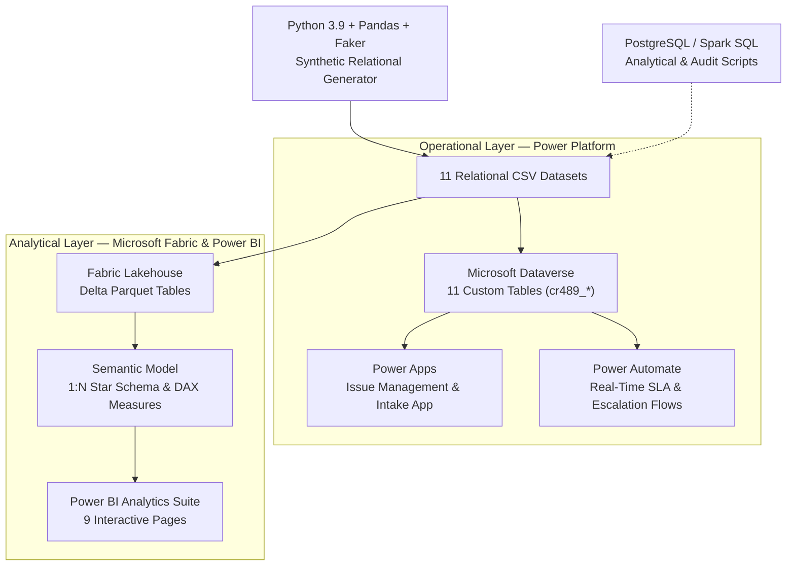

---

## 🗄️ Relational Data Model (11 Tables)

A realistic 2,200-issue operational dataset with over 11,000 historical lifecycle events was generated using Python and loaded into both Dataverse and Fabric.

### Semantic Model Relationship Diagram (Star Schema)
The analytical model follows a Kimball-style star schema centered on `issues`, connected via one-to-many (`1:N`) single-directional relationships to dimension tables:

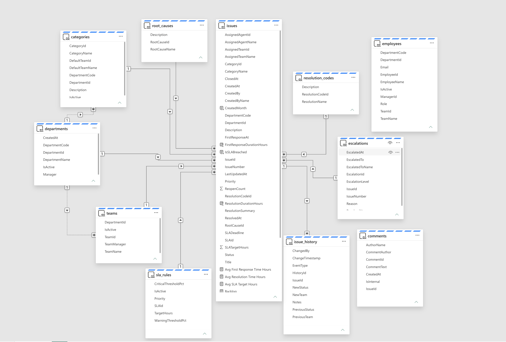

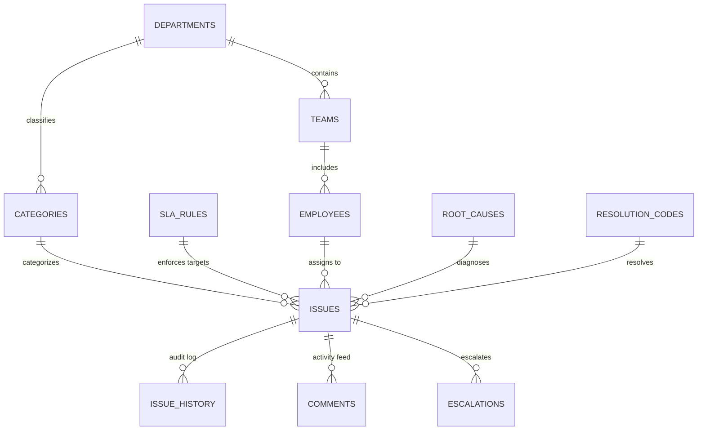

| Table Name | Records | Description | Primary Key |
|---|---:|---|---|
| `issues` | 2,200 | Core fact table: Priority, Status, SLA deadlines, timestamps | `IssueId` |
| `issue_history` | 11,232 | Append-only audit log: Status changes, assignments, transfers | `HistoryId` |
| `comments` | 4,073 | Operational activity log: Internal team notes & requester updates | `CommentId` |
| `escalations` | 315 | Manager intervention records when SLA thresholds are breached | `EscalationId` |
| `employees` | 96 | Directory of requesters, operational agents and team managers | `EmployeeId` |
| `categories` | 24 | Standard operational categories mapped to departments | `CategoryId` |
| `teams` | 10 | Specialized operational teams (IT Infrastructure, Finance Ops...) | `TeamId` |
| `root_causes` | 10 | Standardized root cause taxonomy (Software Bug, User Error...) | `RootCauseId` |
| `resolution_codes` | 9 | Closing classification (Code Fix, Config Change, Workaround...) | `ResolutionCodeId` |
| `departments` | 6 | IT, Finance, Procurement, HR, Operations, Sales Ops | `DepartmentId` |
| `sla_rules` | 4 | Priority-based SLA targets (Critical: 4h, High: 8h, Med: 24h, Low: 72h) | `SLAId` |

---

## 📊 Power BI Analytics Suite (9 Pages)

The Power BI reporting layer provides multi-dimensional operational insights across 9 dedicated analytical dashboards:

---

### Page 1: Operasyonel Genel Bakış & KPI Özeti (Executive Overview)
High-level operational health dashboard showing headline volume, backlog, SLA compliance rate (78.14%), average resolution time (17.84h), department volume distribution, top categories treemap, and team workloads.

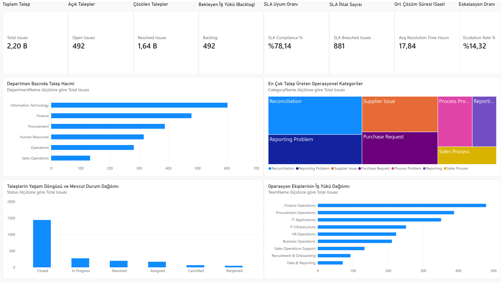

---

### Page 2: Departman & Kategori Analizi (Department & Category Breakdown)
Deep-dive into operational friction points across business units. Features horizontal volume ranking of all 24 categories, priority distribution donut, and interactive operational team slicer buttons.

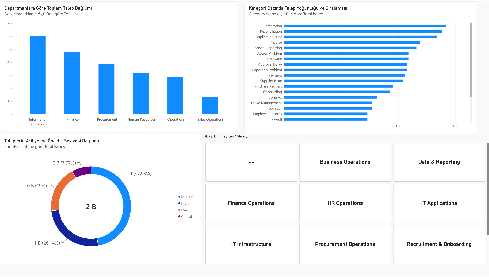

---

### Page 3: SLA & Eskalasyon Performansı (SLA & Escalation Intelligence)
Performance evaluation combining a **Team Risk & Performance Scatter Matrix** (Volume vs. Resolution Time vs. Breaches), team-by-priority SLA breach cross-tab, an executive **SLA Target Gauge** (%78.14 vs. %90.00 target), and escalation priority breakdown.

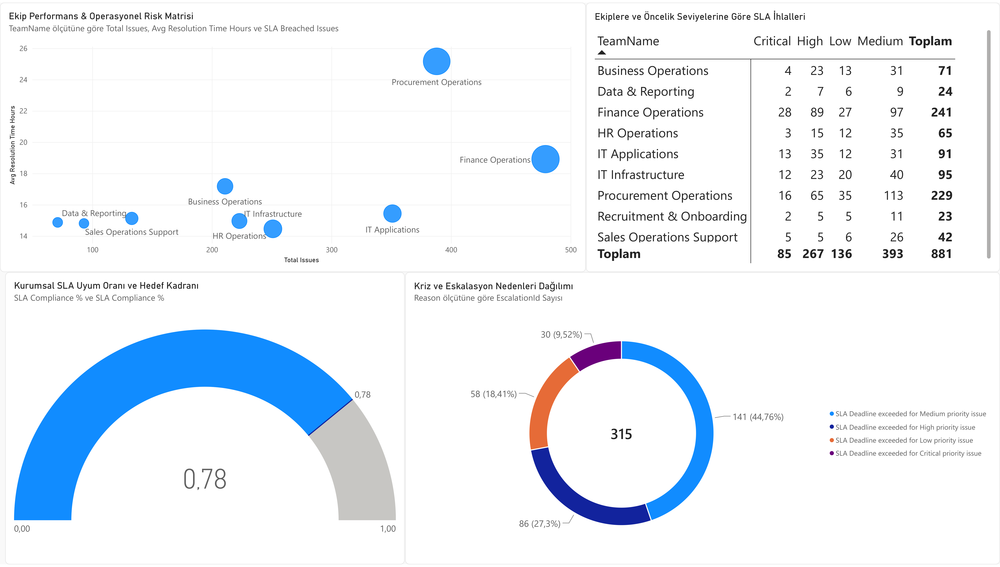

---

### Page 4: Kök Neden & Çözüm Kalitesi (Root Cause & Resolution Intelligence)
Root cause analysis featuring a categorical **Treemap** of failure causes (Data Quality, Missing Approval, Process Design...), department-level chronic reopened issues analysis, closing resolution methods, and a **Root Cause vs. Resolution Cross-Audit Matrix**.

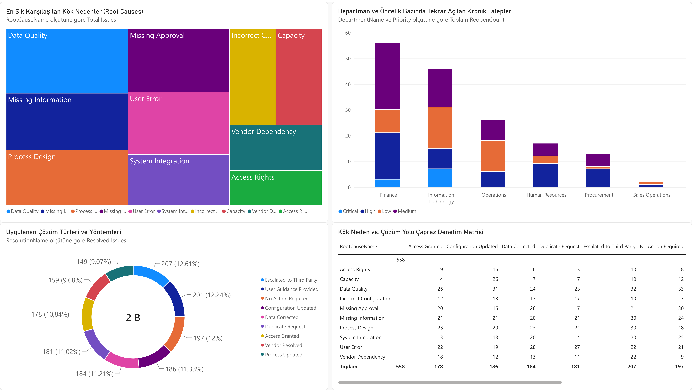

---

### Page 5: Süreç Zekası & Darboğaz Analizi (Process Intelligence & Audit Log)
Mining 11,232 lifecycle events to uncover operational bottlenecks: Lifecycle event breakdown, inter-team transfer volumes, and a **Status Transition Matrix** showing exact transition frequencies (In Progress → Waiting, Assigned → In Progress).

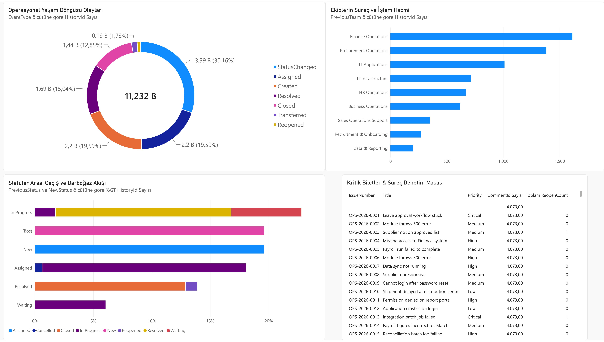

---

### Page 6: Operasyon Masası & Detay Denetimi (Team Workbench & Ledger)
Interactive team manager workbench featuring dual-metric agent capacity analysis (Total Issues vs. Open Backlog per agent), multi-select slicers, and a real-time ticket audit ledger.

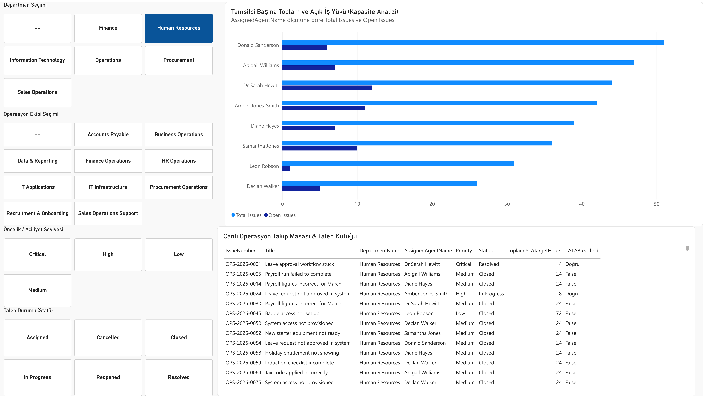

---

### Page 7: Departman Kıyaslama & Verimlilik Karnesi (Department Benchmarking)
Side-by-side benchmarking of the 6 operational departments: Efficiency scatter plot, an executive **Department Operational Scorecard Table** (Volume, Open, Resolution Time, SLA%, Reopen Count), priority compositions, and average duration treemap.

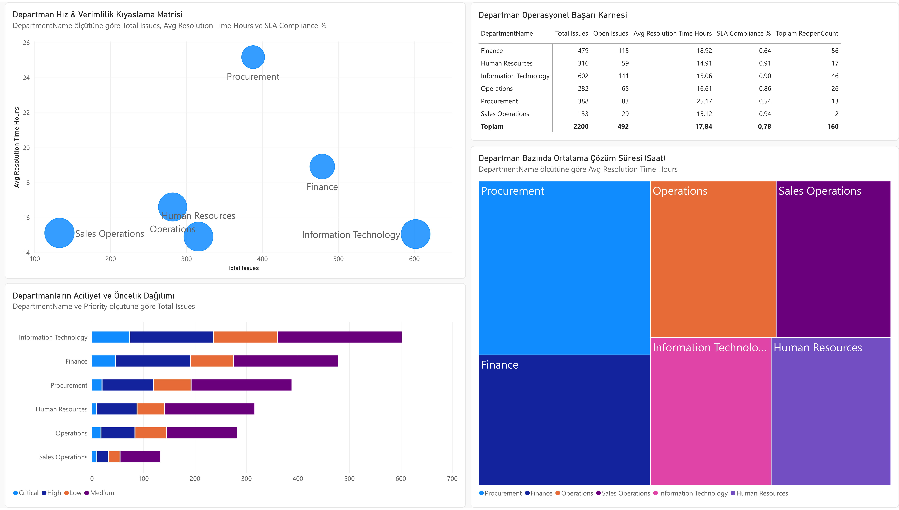

---

### Page 8: İletişim & İş Birliği Analizi (Voice of Operations & Activity Feed)
Analysis of 4,073 operational comments: Internal team notes (24.11%) vs. public requester communications (75.89%), active communication contributors, and a **Live Activity Feed Table** displaying actual ticket commentary and timestamps.

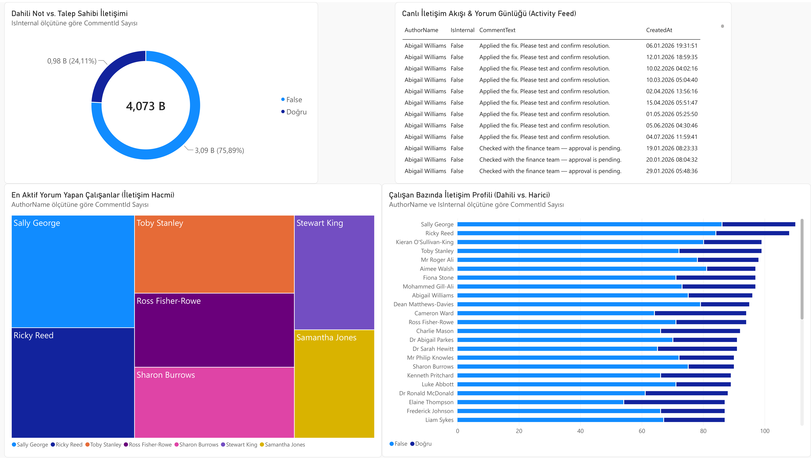

---

### Page 9: Operasyonel Risk & Süreç Hunisi (Operational Risk & Funnel Management)
Conversion and risk control page featuring an **Operational Process Funnel** (Closed → In Progress → Resolved → Assigned), overall SLA compliance ratio donut, manager escalation distribution, and an **Urgent Critical Action Desk ("Yangın Masası")** filtering unresolved critical issues for immediate intervention.

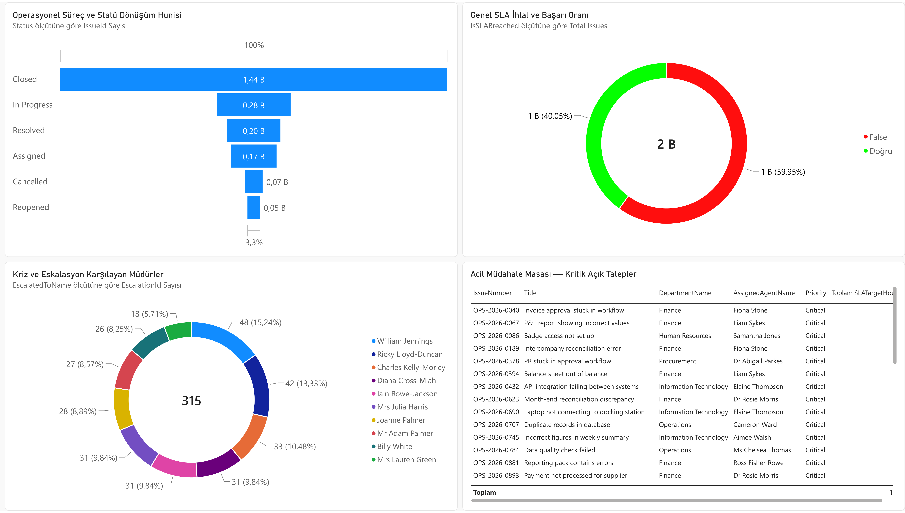

---

## 📱 Power Apps — Operational Issue Management App

Built on Microsoft Dataverse to provide role-based issue intake and status management:

### 1. Active Issue Registry (`Etkin Sorun Kaydı`)
Live operational workbench displaying all active issues with multi-field search, filtering, and status tracking:

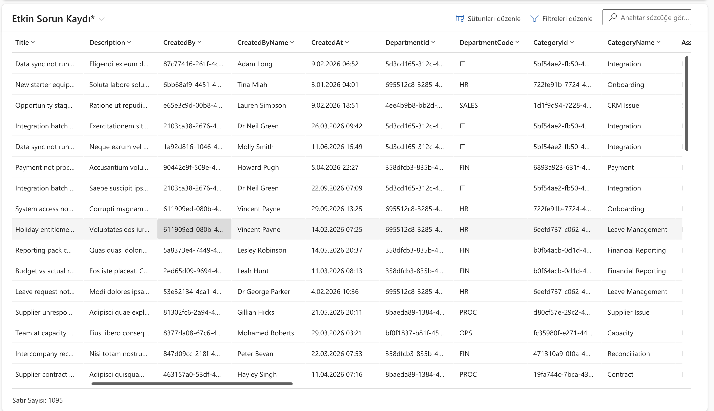

### 2. Issue Intake & Edit Form
Standardized submission form capturing title, description, priority, category, department routing, and SLA deadlines:

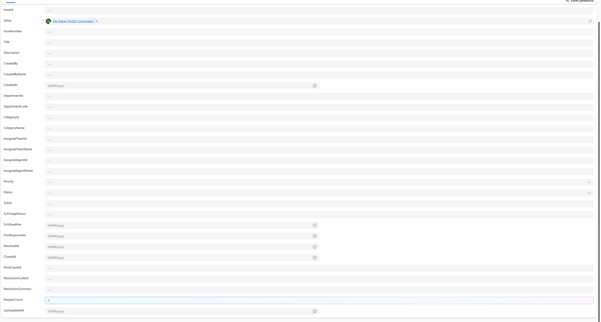

---

## 🗃️ Microsoft Dataverse — Custom Data Layer

11 relational custom tables (`cr489_*`) provisioned in Microsoft Dataverse with custom schemas, primary keys, relationships, and lookups:

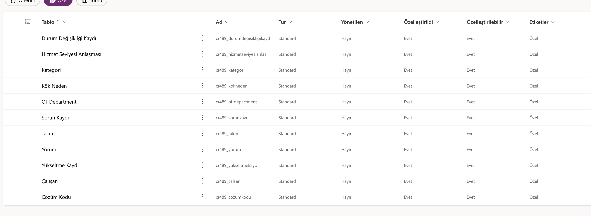

---

## ⚡ Power Automate — Event-Driven SLA Automation

Automated cloud flow configured to monitor Dataverse and trigger instant notifications:

1. **Trigger:** `When a row is added, modified or deleted` — Microsoft Dataverse (Scope: Organization)
2. **Action:** `Send an email (V2)` — Office 365 Outlook delivering ticket number, priority, summary and SLA requirements.

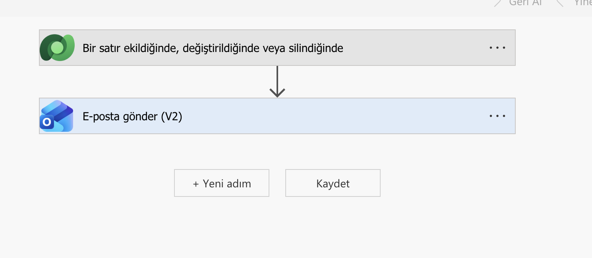

---

## 💻 Python & SQL Engineering Layer

### Synthetic Data Generator (`python/generate_data.py`)
Generates 11 relational datasets using Pandas and Faker with built-in realistic business logic:
- Business-hours SLA calculation
- Intentional variance in department efficiency (e.g., Procurement SLA challenges, IT high volume)
- Realistic lifecycle transition chains in `issue_history`

### Data Quality Validator (`python/validate_data.py`)
Automated validation script testing:
- Primary / Foreign key referential integrity across all 11 tables
- Timestamp chronology checks (`CreatedAt <= FirstResponseAt <= ResolvedAt <= ClosedAt`)
- Null value thresholds and valid enum constraints

### Analytical Reference Queries (`sql/`)
PostgreSQL-compatible SQL scripts demonstrating query-level analysis:
- `01_schema_reference.sql`: Full DDL with primary and foreign keys
- `02_operational_queries.sql`: Backlog calculation, department volume rankings
- `03_sla_analysis.sql`: Compliance rates, breach duration statistics
- `04_process_analysis.sql`: Stage transition durations and bottleneck identification
- `05_data_quality_checks.sql`: Automated SQL test assertions

---

## 📂 Project Structure

```
opsinsight-power-platform/
├── README.md                          # Comprehensive project documentation
├── LICENSE                            # MIT License
├── data/                              # Data storage
│   ├── generated/                     # Generated relational CSV datasets (11 files)
│   └── excel/                         # Spreadsheet backups for Dataverse import
├── docs/                              # Architecture and design specifications
│   ├── architecture.md
│   ├── business-requirements.md
│   ├── data-model.md
│   ├── deployment-guide.md
│   └── ...
├── power-bi/                          # Power BI assets
│   ├── data-dictionary.md             # Semantic model data dictionary
│   ├── measures.md                    # Complete DAX measures library
│   └── report-design.md               # Visual design specifications
├── power-platform/                    # Power Platform assets
│   ├── solution-notes/
│   │   └── fabric_load_tables.py      # PySpark Delta table loader for Fabric
│   └── tables/                        # Dataverse table specifications
├── python/                            # Data engineering scripts
│   ├── generate_data.py               # Synthetic relational data generator
│   ├── validate_data.py               # Automated data quality checker
│   ├── extract_pdf_pages.py           # High-resolution report extractor
│   └── requirements.txt               # Python dependencies
├── sql/                               # Analytical SQL scripts
│   ├── 01_schema_reference.sql
│   ├── 02_operational_queries.sql
│   ├── 03_sla_analysis.sql
│   ├── 04_process_analysis.sql
│   └── 05_data_quality_checks.sql
└── screenshots/                       # 14 high-resolution platform screenshots
    ├── fabric-semantic-model.png      # Star schema relationship view
    ├── dataverse-tables.png           # Dataverse tables list
    ├── powerapps-list.png             # Active issue list screen
    ├── powerapps-form.png             # Issue submission form
    ├── powerautomate-flow.png         # Cloud workflow design
    └── powerbi-01 to 09 (*.png)       # 9 Power BI report pages
```

---

## 🎓 Key Competencies Demonstrated

- **Business Intelligence & Reporting:** Microsoft Power BI, DAX (Iterators, Time Intelligence, Measures), Report UX Design
- **Cloud Analytics:** Microsoft Fabric Lakehouse, Delta Lake, Semantic Modeling, Star Schema Design
- **Low-Code Business Applications:** Microsoft Power Apps (Canvas App, Dataverse CRUD, Forms)
- **Workflow Automation:** Microsoft Power Automate, Event-Driven Triggers, Email Integration
- **Data Engineering & Scripting:** Python 3.9, Pandas, Faker, Data Modeling, PySpark
- **Database & Query Optimization:** SQL (PostgreSQL / Spark SQL), DDL, Window Functions, CTEs
- **Version Control & Documentation:** Git, GitHub, Markdown, Mermaid Diagrams

---

*This project was developed as a portfolio and demonstration project. All data is synthetic; no confidential or real personal information is used.*
