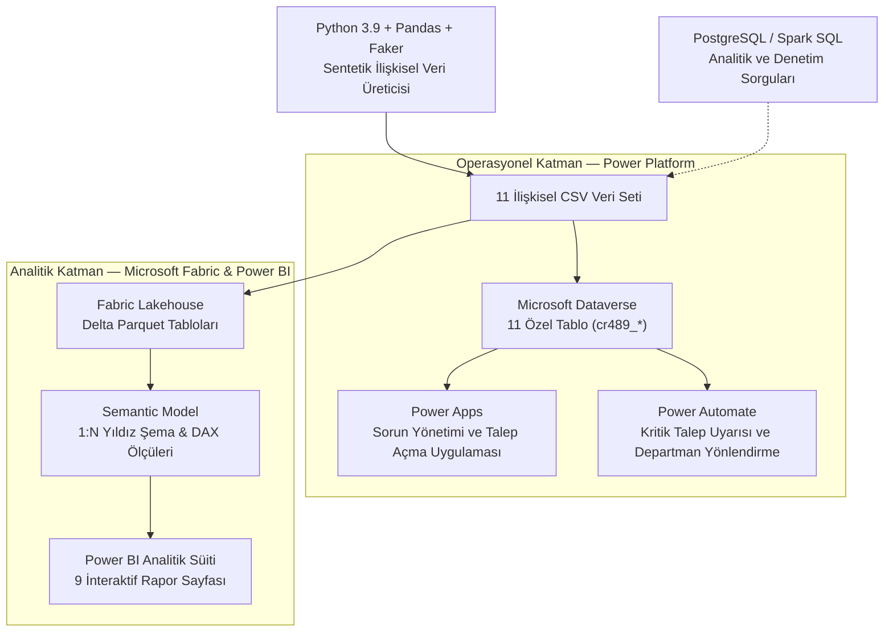
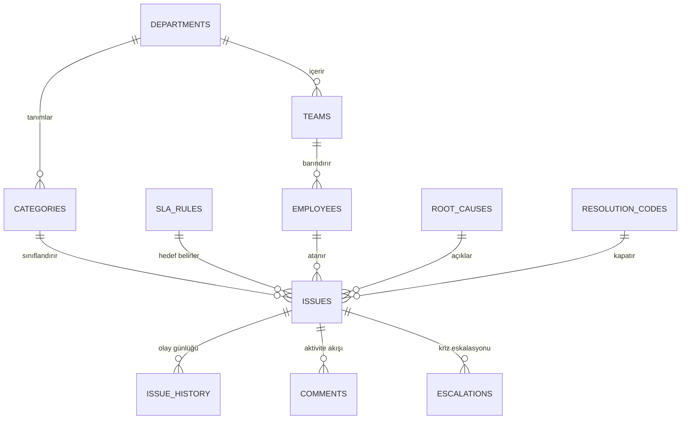
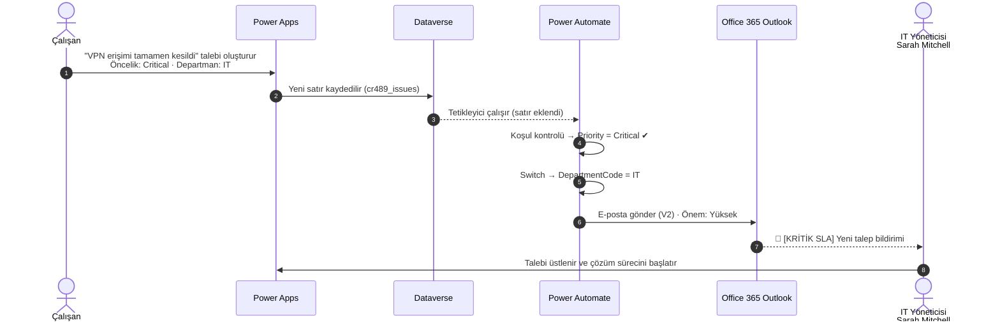

# OpsInsight — Operasyonel Sorun, SLA & Süreç Zekası Platformu

> **Kurumsal Portföy Projesi** — **Microsoft Power Platform** ve **Microsoft Fabric** üzerinde geliştirilmiş uçtan uca operasyonel zeka ve süreç analitiği platformu.  
> Kurgusal organizasyon: **Northstar Operations Group** · Tüm veriler sentetiktir.


---

## 📌 Yönetici Özeti (Executive Summary)

Kurumsal şirketlerde departmanlar arası operasyonel aksaklıklar (donanım arızaları, geciken onaylar, hatalı faturalar, sistem entegrasyon kopuklukları) sıklıkla e-posta, Excel tabloları, Teams yazışmaları veya telefon görüşmeleri gibi dağınık kanallardan yürütülür. Bu durum, yönetimin iş yükünü ölçemediği, SLA sözleşmelerini denetleyemediği ve süreç darboğazlarını tespit edemediği ciddi bir operasyonel kör nokta oluşturur.

**OpsInsight**, tüm departmanlardaki sorun bildirimlerini tek bir merkezde toplar ve günlük operasyonel hareketleri **ölçülebilir, denetlenebilir ve aksiyona dönüştürülebilir süreç zekasına** dönüştürür.

**Temel Çalışma Prensibi: Kaydet → Yönet → İzle → Analiz Et → İyileştir**

```
Çalışanlar / Operasyon Temsilcileri / Yöneticiler
                        │
                        ▼
             Power Apps Canvas App
         (Canlı talep yönetimi ve kayıt formu)
                        │
                        ▼
               Microsoft Dataverse
     (11 ilişkisel tablo ve operasyonel iş kuralları)
           /                         \
          ▼                           ▼
    Power Automate          Microsoft Fabric (Lakehouse)
(Gerçek zamanlı SLA & bildirim)       │
                                      ▼
                        Semantic Model (Star Schema)
                                      │
                                      ▼
                             Power BI Analitiği
                          (9 sayfalık kurumsal süit)
```

---

## 🏛️ Sistem Mimarisi

Çözüm; canlı iş uygulamalarının ve otomasyonun çalıştığı **Operasyonel Katman** ile büyük veri ambarı ve analitik modellemenin çalıştığı **Analitik Katman**'ı birbirinden net bir şekilde ayırır. Bu iki katmanlı yapı, gerçek kurumsal veri platformu mimarisini birebir yansıtır.



---

## 🗄️ İlişkisel Veri Modeli (11 Tablo)

Python ile oluşturulan ve gerçekçi iş mantığı içeren 2.200 bilet ve 11.000'i aşkın yaşam döngüsü olayı, hem Dataverse'e hem de Microsoft Fabric Lakehouse'a yüklenmiştir.

### Semantic Model İlişki Şeması (Star Schema)
Analitik model; merkezde `issues` (hareket) tablosunun yer aldığı ve etrafındaki boyut tablolarına bire-çok (`1:N`) tek yönlü filtreleme ile bağlandığı Kimball yıldız şeması (Star Schema) standardındadır:




| Tablo Adı | Kayıt Sayısı | Açıklama | Birincil Anahtar |
|---|---:|---|---|
| `issues` | 2.200 | Ana hareket tablosu: Öncelik, Durum, SLA hedefleri, zaman damgaları | `IssueId` |
| `issue_history` | 11.232 | Süreç denetim günlüğü: Durum değişiklikleri, atamalar, transferler | `HistoryId` |
| `comments` | 4.073 | Operasyonel aktivite günlüğü: Dahili ekip notları ve dış yazışmalar | `CommentId` |
| `escalations` | 315 | SLA aşımlarında üst yöneticiye yapılan müdahale kayıtları | `EscalationId` |
| `employees` | 96 | Talep sahipleri, operasyon temsilcileri ve ekip müdürleri rehberi | `EmployeeId` |
| `categories` | 24 | Departmanlarla eşleştirilmiş standart operasyonel kategori listesi | `CategoryId` |
| `teams` | 10 | Uzmanlaşmış operasyon ekipleri (IT Altyapı, Finans Operasyon...) | `TeamId` |
| `root_causes` | 10 | Standart kök neden kataloğu (Yazılım Hatası, Kullanıcı Hatası...) | `RootCauseId` |
| `resolution_codes` | 9 | Kapanış yöntemi sınıflandırması (Kod Düzeltme, Geçici Yama...) | `ResolutionCodeId` |
| `departments` | 6 | IT, Finans, Satın Alma, İK, Operasyon, Satış Operasyonları | `DepartmentId` |
| `sla_rules` | 4 | Öncelik bazlı SLA hedefleri (Kritik: 4h, Yüksek: 8h, Orta: 24h, Düşük: 72h) | `SLAId` |

---

## 📊 Power BI Analitik Süiti (9 Sayfa)

Raporlama katmanı, operasyonel performansı 9 bağımsız analitik sayfada çok boyutlu olarak sunar:

---

### Sayfa 1: Operasyonel Genel Bakış & KPI Özeti (Executive Overview)
Şirket genelindeki talep hacmini, birikmiş iş yükünü (492 açık talep), SLA uyum oranını (%78,14), ortalama çözüm süresini (17,84 saat), departman dağılımını, en yoğun ilk 7 kategoriyi (Treemap) ve operasyon ekiplerinin iş yükünü gösteren üst yönetim özet ekranı.


---

### Sayfa 2: Departman & Kategori Analizi (Department & Category Breakdown)
İş birimlerindeki operasyonel aksaklıkların derinlemesine analizi. 24 kategorinin yatay hacim sıralaması, öncelik seviyeleri donutu ve interaktif operasyon ekibi filtre butonları.


---

### Sayfa 3: SLA & Eskalasyon Performansı (SLA & Escalation Intelligence)
Performans değerlendirmesini bir araya getiren sayfa: **Ekip Risk ve Performans Matrisi (Scatter Plot)** (İş Hacmi vs. Çözüm Süresi vs. İhlaller), takımlara ve önceliklere göre ihlal tablosu, **SLA Hedef Kadranı (%78 Uyum vs. %90 Hedef)** ve 315 eskalasyonun öncelik dağılımı.


---

### Sayfa 4: Kök Neden & Çözüm Kalitesi (Root Cause & Resolution Intelligence)
Kök neden analitiği: Sorun yaratan faktörlerin ağırlıklı **Ağaç Haritası (Treemap)** (Veri Kalitesi, Eksik Onay, Süreç Tasarımı...), departman bazında tekrar açılan (Reopen) kronik sorunlar, kapanış yöntemleri ve **Kök Neden vs. Çözüm Yolu Çapraz Denetim Matrisi**.


---

### Sayfa 5: Süreç Zekası & Darboğaz Analizi (Process Intelligence & Audit Log)
11.232 yaşam döngüsü olayını analiz eden süreç madenciliği ekranı: Yaşam döngüsü olay dağılımı, ekipler arası transfer hacmi ve taleplerin hangi aşamada tıkandığını gösteren **Statüler Arası Geçiş Akış Matrisi** (In Progress → Waiting, Assigned → In Progress).


---

### Sayfa 6: Operasyon Masası & Detay Denetimi (Team Workbench & Ledger)
Ekip liderleri için tasarlanmış interaktif çalışma masası: Temsilci başına toplam ve açık iş yükü (Kapasite Analizi), çoklu filtre dilimleyicileri ve tek tek biletlerin denetlendiği canlı operasyon tablosu.


---

### Sayfa 7: Departman Kıyaslama & Verimlilik Karnesi (Department Benchmarking)
6 operasyonel departmanın yan yana kıyaslanması: Hız ve verimlilik dağılım grafiği, resmi **Departman Operasyon Başarı Karnesi Tablosu** (Hacim, Açık İş, Çözüm Saati, SLA%, Yeniden Açılma), departman öncelik oranları ve ortalama süre kutuları.


---

### Sayfa 8: İletişim & İş Birliği Analizi (Voice of Operations & Activity Feed)
4.073 operasyonel yorumun analizi: Dahili ekip içi notlar (%24,11) ile talep sahibi dış yazışmaları (%75,89), en aktif yorumcular ve gerçek bilet yorumlarının anlık aktığı **Canlı İletişim Akışı & Yorum Günlüğü Tablosu (Activity Feed)**.


---

### Sayfa 9: Operasyonel Risk & Süreç Hunisi (Operational Risk & Funnel Management)
Dönüşüm ve risk kontrol sayfası: **Operasyonel Süreç Hunisi (Funnel Chart)** (Kapalı → İncelemede → Çözüldü → Atandı), genel SLA uyum halkası, kriz karşılayan 10 yöneticinin dağılımı ve derhal aksiyon bekleyen çözülmemiş kritik biletleri listeleyen **Acil Müdahale Masası ("Yangın Masası")**.


---

## 📱 Power Apps — Operasyonel Talep Yönetimi Uygulaması

Microsoft Dataverse üzerinde inşa edilmiş, çalışanların bilet açabildiği ve operasyon ekiplerinin durum güncelleyebildiği canlı tuval uygulaması:

### 1. Canlı Bilet Listesi (`Etkin Sorun Kaydı`)
Tüm aktif taleplerin listelendiği, çoklu arama ve filtreleme destekleyen operasyonel liste arayüzü:


### 2. Talep Kayıt & Düzenleme Formu
Başlık, açıklama, öncelik, kategori, departman yönlendirmesi ve SLA teslim tarihlerini toplayan standart giriş formu:


---

## 🗃️ Microsoft Dataverse — Özel Veri Katmanı

Microsoft Dataverse ortamında oluşturulmuş; özel şemalar, birincil anahtarlar ve ilişkisel arama (lookup) alanları barındıran 11 kurumsal tablo (`cr489_*`):


---

## ⚡ Power Automate — Kritik Talep Uyarısı ve Departman Bazlı Akıllı Yönlendirme

**Akış adı:** `OpsInsight – Critical Issue Department Alert`

Bu akış, Dataverse'e eklenen her yeni talebi anında kontrol eder. Herkese toplu e-posta göndermek yerine **yalnızca öncelik seviyesi `Critical` olan talepleri** yakalar ve talebin ait olduğu departmanın yöneticisine **yüksek önemli** bir uyarı e-postası gönderir. Amaç, gereksiz bildirim kalabalığını (alert fatigue) önlemek ve 4 saatlik kritik SLA süresi dolmadan doğru kişinin harekete geçmesini sağlamaktır.

### 🔀 Akış Mimarisi


### ⏱️ Uçtan Uca Senaryo (Örnek: IT Departmanında Kritik Talep)



### 🗺️ Yönlendirme Tablosu

| `DepartmentCode` | Departman | Bildirim Alıcısı | Kritik SLA Hedefi |
|:---:|---|---|:---:|
| `IT` | Bilgi Teknolojileri | Sarah Mitchell | 4 saat |
| `FIN` | Finans | David Thompson | 4 saat |
| `HR` | İnsan Kaynakları | Emma Clarke | 4 saat |
| `PROC` | Satın Alma | Robert Hughes | 4 saat |
| `OPS` | Operasyon | Linda Foster | 4 saat |
| `SALES` | Satış Operasyonları | Mark Patterson | 4 saat |
| *Default* | Eşleşmeyen / boş kod | Genel Operasyon Masası | 4 saat |

### 📧 E-posta İçeriği

Her dalda aynı şablon kullanılır; içerik Dataverse'ten gelen dinamik alanlarla doldurulur:

```text
Konu   : [KRİTİK SLA] Yeni Talep – {Title}
Önem   : Yüksek (High)

Sayın {Departman Yöneticisi},

Departmanınıza kritik öncelikli yeni bir talep atanmıştır.

  Talep No   : {IssueNumber}
  Başlık     : {Title}
  Öncelik    : {Priority}
  Departman  : {DepartmentCode}
  Açıklama   : {Description}
  Oluşturulma: {CreatedOn}

Kritik taleplerde SLA hedefi 4 saattir. Lütfen talebi en kısa sürede üstlenin.

— OpsInsight Otomatik Bildirim Sistemi
```

### 🧠 Tasarım Kararları

| Karar | Gerekçe |
|---|---|
| **Yalnızca `Eklendi` tetikleyicisi** | Kayıt her güncellendiğinde aynı uyarının tekrar gönderilmesini engeller. |
| **Önce Koşul, sonra Switch** | Kritik olmayan talepler en başta elenir; akış gereksiz yere dallara girmez. |
| **İç içe If yerine `Switch`** | 6 departman için okunması ve bakımı kolay tek bir yapı; yeni departman eklemek yalnızca bir `Case` eklemek demektir. |
| **`Default` güvenlik dalı** | Departman kodu boş veya hatalı gelse bile kritik talep sahipsiz kalmaz. |
| **Yüksek önem (High Importance)** | Uyarı, yöneticinin gelen kutusunda diğer e-postalardan ayrışır. |

---

## 💻 Python & SQL Veri Mühendisliği Katmanı

### Sentetik Veri Üreticisi (`python/generate_data.py`)
Pandas ve Faker kütüphaneleri kullanılarak 11 ilişkisel tabloyu gerçekçi iş mantığı kurallarıyla üretir:
- Mesai saatlerine duyarlı SLA hesaplama kuralları
- Departmanlar arası kasıtlı performans varyansları (Satın Alma departmanındaki tedarikçi gecikmeleri, IT'deki yüksek hacim)
- `issue_history` tablosundaki mantıksal yaşam döngüsü durum geçiş zincirleri

### Veri Kalitesi Doğrulayıcısı (`python/validate_data.py`)
Otomatik doğrulama scripti:
- 11 tablonun tamamında birincil ve yabancı anahtar (PK-FK) referans bütünlüğü testleri
- Kronolojik tutarlılık kontrolleri (`CreatedAt <= FirstResponseAt <= ResolvedAt <= ClosedAt`)
- Null değer eşikleri ve geçerli enum kısıtlamaları

### Analitik Referans SQL Sorguları (`sql/`)
PostgreSQL ve Spark SQL uyumlu derinlemesine analiz sorguları:
- [`01_schema_reference.sql`](sql/01_schema_reference.sql): Birincil ve yabancı anahtarlı tam DDL şeması
- [`02_operational_queries.sql`](sql/02_operational_queries.sql): Backlog hesaplama, departman hacim sıralamaları
- [`03_sla_analysis.sql`](sql/03_sla_analysis.sql): SLA uyum oranları, gecikme süresi istatistikleri
- [`04_process_analysis.sql`](sql/04_process_analysis.sql): Aşama geçiş süreleri ve darboğaz tespiti
- [`05_data_quality_checks.sql`](sql/05_data_quality_checks.sql): Otomatik SQL doğrulama testleri
- [`06_advanced_operational_analytics.sql`](sql/06_advanced_operational_analytics.sql): İlk Yanıt (MTTA) ve Çözüm (MTTR) süresi, pinpon transferler, ihlal derinliği, temsilci karnesi, statü bekleme süreleri ve kümülatif backlog trendi

---

## 📂 Proje Dizin Yapısı

```
opsinsight-power-platform/
├── README.md                          # Kapsamlı kurumsal proje dokümantasyonu
├── LICENSE                            # MIT Açık Kaynak Lisansı
├── data/                              # Veri depolama alanı
│   ├── generated/                     # Üretilen 11 ilişkisel CSV veri seti
│   └── excel/                         # Dataverse içe aktarımı için Excel yedekleri
├── docs/                              # Mimari, iş gereksinimleri ve dağıtım kılavuzları
├── power-bi/                          # Power BI analitik varlıkları
│   ├── data-dictionary.md             # Semantic model veri sözlüğü
│   ├── measures.md                    # Eksiksiz DAX ölçü kütüphanesi
│   └── report-design.md               # Rapor görsel tasarım şartnamesi
├── power-platform/                    # Power Platform bileşenleri
│   ├── solution-notes/
│   │   └── fabric_load_tables.py      # Fabric için PySpark Delta tablo yükleyicisi
│   └── tables/                        # Dataverse tablo tanımları
├── python/                            # Veri mühendisliği scriptleri
│   ├── generate_data.py               # Sentetik ilişkisel veri üreticisi
│   ├── validate_data.py               # Otomatik veri kalitesi doğrulayıcısı
│   ├── extract_pdf_pages.py           # Yüksek çözünürlüklü rapor çıkarıcı
│   └── requirements.txt               # Python bağımlılıkları
├── sql/                               # Analitik ve denetim SQL sorguları (6 dosya)
│   ├── 01_schema_reference.sql
│   ├── 02_operational_queries.sql
│   ├── 03_sla_analysis.sql
│   ├── 04_process_analysis.sql
│   ├── 05_data_quality_checks.sql
│   └── 06_advanced_operational_analytics.sql
└── screenshots/                       # 13 adet yüksek çözünürlüklü platform görseli
    ├── fabric-semantic-model.png      # Yıldız şema ilişki diyagramı
    ├── dataverse-tables.png           # Dataverse tablo listesi
    ├── powerapps-list.png             # Aktif talep listesi ekranı
    ├── powerapps-form.png             # Talep giriş formu ekranı
    └── powerbi-01 to 09 (*.png)       # 9 sayfalık Power BI rapor görselleri
```

---

## 🎓 Sergilenen Temel Yetkinlikler

- **İş Zekası & Raporlama:** Microsoft Power BI, DAX (Iterators, Time Intelligence, Measures), Rapor Tasarımı & UX
- **Bulut Veri Mimarisi:** Microsoft Fabric Lakehouse, Delta Lake, Semantic Modeling, Yıldız Şema (Star Schema) Tasarımı
- **Düşük Kodlu İş Uygulamaları (Low-Code):** Microsoft Power Apps (Canvas App, Dataverse CRUD, Form Yönetimi)
- **İş Akışı Otomasyonu:** Microsoft Power Automate, Olay Odaklı Tetikleyiciler (Event-Driven Triggers), Koşullu Mantık, Switch ile Departman Bazlı Yönlendirme, E-posta Entegrasyonu
- **Veri Mühendisliği & Betik Geliştirme:** Python 3.9, Pandas, Faker, Veri Modelleme, PySpark
- **Veritabanı & Sorgu Optimizasyonu:** SQL (PostgreSQL / Spark SQL), DDL, Pencere Fonksiyonları (Window Functions), CTE
- **Versiyon Kontrolü & Dokümantasyon:** Git, GitHub, Markdown, Mermaid Diyagramları

---

*Bu proje, staj ve iş başvuruları için teknik portföy projesi olarak geliştirilmiştir. Tüm veriler sentetiktir; hiçbir gizli veya gerçek kurumsal/kişisel bilgi içermez.*
