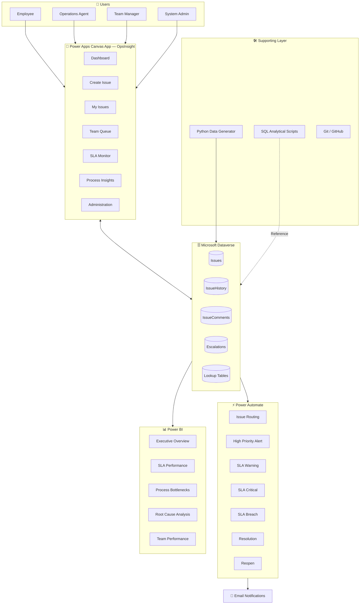
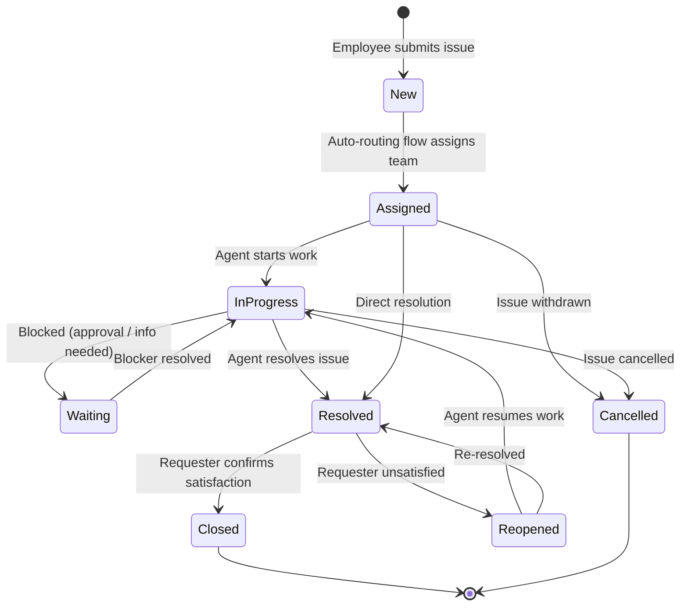
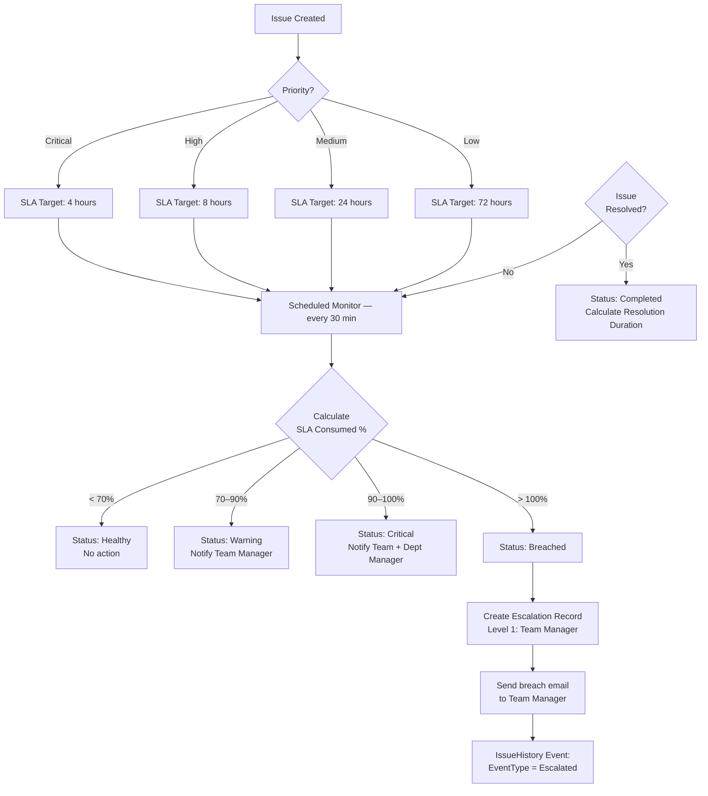
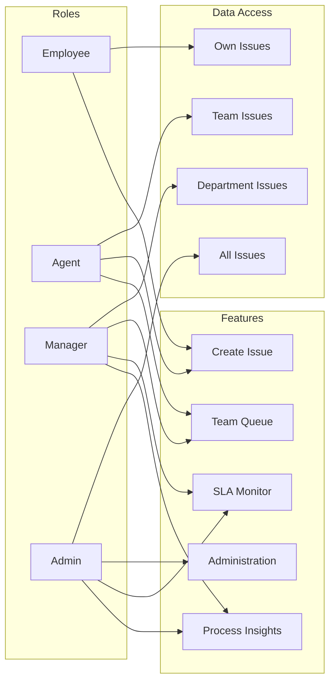
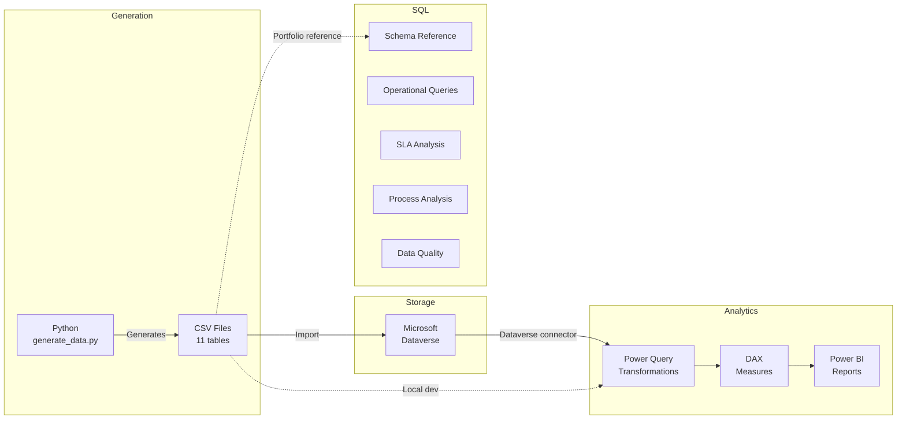

# OpsInsight — Architecture Diagrams

---

## 1. System Architecture

---

## 2. Issue Lifecycle Flow

---

## 3. Entity Relationship Diagram

```mermaid
erDiagram
    DEPARTMENTS {
        uuid DepartmentId PK
        string DepartmentName
        string DepartmentCode
        string Manager
        bool IsActive
        datetime CreatedAt
    }

    TEAMS {
        uuid TeamId PK
        string TeamName
        uuid DepartmentId FK
        string TeamManager
        bool IsActive
    }

    EMPLOYEES {
        uuid EmployeeId PK
        string EmployeeName
        string Email
        uuid DepartmentId FK
        uuid TeamId FK
        uuid ManagerId FK
        string Role
        bool IsActive
    }

    ISSUE_CATEGORIES {
        uuid CategoryId PK
        string CategoryName
        uuid DepartmentId FK
        uuid DefaultTeamId FK
        string Description
        bool IsActive
    }

    SLA_RULES {
        uuid SLAId PK
        string Priority
        decimal TargetHours
        int WarningThresholdPct
        int CriticalThresholdPct
        bool IsActive
    }

    ROOT_CAUSES {
        uuid RootCauseId PK
        string RootCauseName
        uuid CategoryId FK
        string Description
    }

    RESOLUTION_CODES {
        uuid ResolutionCodeId PK
        string ResolutionName
        string Description
    }

    ISSUES {
        uuid IssueId PK
        string IssueNumber
        string Title
        text Description
        uuid CreatedBy FK
        datetime CreatedAt
        uuid DepartmentId FK
        uuid CategoryId FK
        uuid AssignedTeamId FK
        uuid AssignedAgentId FK
        string Priority
        string Status
        uuid SLAId FK
        datetime SLADeadline
        datetime FirstResponseAt
        datetime ResolvedAt
        datetime ClosedAt
        uuid RootCauseId FK
        uuid ResolutionCodeId FK
        int ReopenCount
        datetime LastUpdatedAt
    }

    ISSUE_HISTORY {
        uuid HistoryId PK
        uuid IssueId FK
        string EventType
        string PreviousStatus
        string NewStatus
        string PreviousTeam
        string NewTeam
        string ChangedBy
        datetime ChangeTimestamp
        text Notes
    }

    ISSUE_COMMENTS {
        uuid CommentId PK
        uuid IssueId FK
        text CommentText
        uuid CommentAuthor FK
        datetime CreatedAt
        bool IsInternal
    }

    ESCALATIONS {
        uuid EscalationId PK
        uuid IssueId FK
        int EscalationLevel
        uuid EscalatedTo FK
        text Reason
        datetime EscalatedAt
        datetime ResolvedAt
    }

    DEPARTMENTS ||--o{ TEAMS : "has"
    DEPARTMENTS ||--o{ EMPLOYEES : "employs"
    DEPARTMENTS ||--o{ ISSUE_CATEGORIES : "owns"
    TEAMS ||--o{ EMPLOYEES : "contains"
    TEAMS ||--o{ ISSUE_CATEGORIES : "handles"
    EMPLOYEES ||--o{ ISSUES : "creates"
    EMPLOYEES ||--o{ ISSUES : "handles"
    DEPARTMENTS ||--o{ ISSUES : "department"
    ISSUE_CATEGORIES ||--o{ ISSUES : "classifies"
    TEAMS ||--o{ ISSUES : "assigned"
    SLA_RULES ||--o{ ISSUES : "governs"
    ROOT_CAUSES ||--o{ ISSUES : "explains"
    RESOLUTION_CODES ||--o{ ISSUES : "resolves"
    ISSUES ||--o{ ISSUE_HISTORY : "tracks"
    ISSUES ||--o{ ISSUE_COMMENTS : "has"
    ISSUES ||--o{ ESCALATIONS : "triggers"
```

---

## 4. SLA Escalation Flow

---

## 5. User Role Access Model

---

## 6. Data Pipeline

